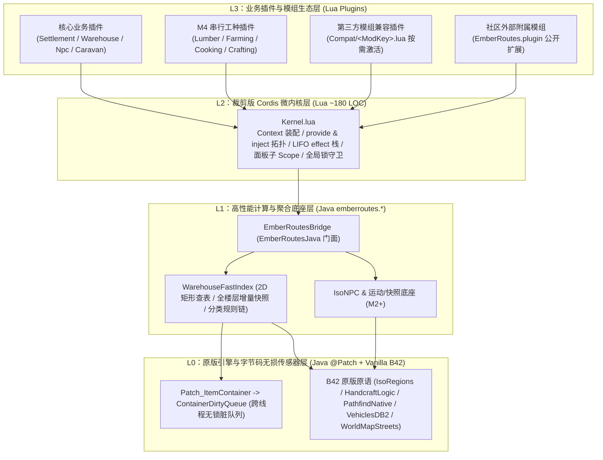

# EmberRoutes V2 全局系统架构与微内核兼容规范

> 日期：2026-11-18｜状态：active｜适用：`EmberRoutesV2` 全生命周期（M1–M6）
> 关联导航：[项目红线 (AGENTS.md)](../AGENTS.md) ｜ [模块路线图与引擎实证 (MODULE_MAP.md)](MODULE_MAP.md) ｜ [V1 复盘与迁移参考 (V1_RETROSPECTIVE_AND_MIGRATION.md)](V1_RETROSPECTIVE_AND_MIGRATION.md)

---

## 1. 架构定位与核心取舍

`EmberRoutesV2` 采用 **「B42 原版引擎原语底座 + Java 高性能计算桥 + 裁剪版 Cordis 微内核（Lua）+ 前置 UI 框架 `EmberUI`」** 的混合架构。设计上严格区分两种“兼容”边界：

1. **内部历史包袱零兼容（严令禁止）**：严禁保留旧版存档格式迁移分支、旧接口别名、转发壳或双轨 fallback（见 [AGENTS.md](../AGENTS.md)）。
2. **外部工坊模组生态高兼容（核心架构目标）**：Project Zomboid 拥有庞大的创意工坊生态。本架构通过**底层原件守恒**天然兼容绝大多数内容型模组，并通过**裁剪版 Cordis 思想（声明式服务注入 + 可逆副作用栈 + 隔离式插件）**解决高阶机制/UI 模组冲突与社区附属子模组扩展。

### 为什么是「裁剪版 Cordis」而非照搬完整版 JS Cordis？

| 维度 | 完整版 JS Cordis（不采纳部分） | EmberRoutes V2 裁剪版微内核（正式采纳） | 取舍依据（B42 引擎实证） |
| :--- | :--- | :--- | :--- |
| **服务访问方式** | 运行时 `Proxy` / 元表 `__index` 动态穿透查找 | **装配期静态注入**：插件在 `apply(ctx)` 一次性捕获服务局部变量，**热路径 0 元表代理、0 动态闭包分配** | PZ 的 Kahlua2 为纯 Java 解释器且**无 JIT**，`OnTick / tickAI / prerender` 严禁元表链查找与临时表分配 |
| **服务生命周期** | 支持运行中随时热拔核心服务并级联挂起依赖方 | **存档会话级静态拓扑**：进档按 `inject` 拓扑挂载，退回主菜单（`OnMainMenuEnter`）按 **LIFO（后进先出）** 统一逆序卸载 | Java `@Patch` 在类加载期一次性织入，工坊模组列表在单次存档内固定；若做运行中核心服务热撤回，必复辟旧版 6 层互锁账本与 `Reconcile` 冻结态 |
| **副作用回收** | `ctx.effect` / `fiber.dispose` 可逆副作用 | **完整保留并强化**：统一托管 `Events` 监听、Store 订阅、原版函数安全包装与全局布尔锁引用计数 | 彻底根治退档切档监听残留、UI 面板反复开关内存泄漏及与第三方模组互踩全局开关 |

---

## 2. 系统四层拓扑与 Java ↔ Lua 职责切分



### 跨语言硬性边界

1. **L0 字节码补丁层（根包 `emberroutes.Patch_*`）**：
   - 因 ZombieBuddy `PatchEngine.collectPatches` 仅按根包精确匹配扫描，**所有 `Patch_*` 类必须严格留在根包 `emberroutes` 下**；只做最薄的无损钩子（`@Patch.OnEnter` / `@Patch.OnExit`），严禁修改原版方法返回值或吞掉原版调用（参考 [Patch_ItemContainer.java](../java-src/src/main/java/emberroutes/Patch_ItemContainer.java)）；
   - 因区块流式加载可能在后台线程触发 `ItemContainer.load`，补丁内**严禁触碰非线程安全的 `KahluaTable` 或调用 Lua 闭包**，只能写入并发无锁结构（如 [ContainerDirtyQueue.java](../java-src/src/main/java/emberroutes/warehouse/ContainerDirtyQueue.java)）。
   - Gradle 的 ArchUnit 测试检查 `Patch_ItemContainer` 及其内部类不直接依赖 Kahlua 类；它不能证明间接调用或运行时线程安全，仍须审查完整调用链。
2. **L1 Java 底座层（`emberroutes.*`）**：
   - 独占承担大规模格点遍历、全楼层世界容器聚合（[WarehouseFastIndex.java](../java-src/src/main/java/emberroutes/warehouse/WarehouseFastIndex.java)）、`IsoRegions` 屋顶封闭查询（[EmberRoutesBridge.java](../java-src/src/main/java/emberroutes/EmberRoutesBridge.java)）、C++ `PathfindNative` 路径拉直与 `ByteBuffer` 实体存读档；
   - Java 层对具体第三方工坊模组保持 **0 硬编码感知**，但向 Lua 暴露规则覆盖入口（如物品分类覆盖表），避免在 Java 中写死封闭白名单。
3. **L2 微内核与 L3 插件层（Lua）**：
   - 负责会话生命周期编排、领域规则配置、原子动作调度、UI 投影展示及第三方模组桥接。

---

## 3. 裁剪版 Cordis 微内核契约规范

微内核目标体量控制在 **200 行以内纯 Lua**（规划路径：`shared/EmberRoutes/Kernel.lua`），不引入重型面向对象层级。

### 3.1 核心原语签名与语义

| 原语 | 职责与严格契约 |
| :--- | :--- |
| `EmberRoutes.plugin(def)` | 登记插件声明：`{ name = string, inject = string[]?, optional = string[]?, when = (fun():boolean)?, apply = fun(ctx) }`。文件 `require` 期仅入表登记，**0 运行时副作用**。 |
| `ctx:provide(name, service)` | 在当前存档会话根上下文注册唯一权威服务（如 `'settlements'`、`'warehouse'`、`'work'`）。重名覆盖直接报错拒绝，防止静默篡改。 |
| `ctx:effect(fn)` / `ctx:defer(cleanupFn)` | 注册可逆副作用：`effect(fn)` 执行初始化并捕获其返回的 `cleanupFn`，`defer(cleanupFn)` 直接压入清理闭包。销毁时严格按 **LIFO（后进先出）** 顺序调用，每个清理器独立 `pcall` 捕获异常并写日志，单点失败绝不阻断后续资源释放。 |
| `ctx:on(eventObj, handler)` | 安全绑定 PZ 原版事件（如 `ctx:on(Events.OnTick, onTick)`），内部立即执行 `eventObj.Add(handler)` 并在当前作用域压入 `eventObj.Remove(handler)` 清理器。 |
| `ctx:subscribe(store, fn)` | 适配数据层监听（如 [SettlementStore.lua](../Contents/mods/EmberRoutes/42/media/lua/shared/EmberRoutes/Settlement/SettlementStore.lua)），要求所有监听注册接口统一返回幂等 `dispose()` 闭包并自动纳入当前作用域回收。 |
| `ctx:acquireGlobalFlag(tbl, key, val)` | **全局状态引用计数守卫**：针对 `ISWorldObjectContextMenu.disableWorldMenu` 等多模组共享全局布尔位，首次获取时快照外部原始值并写入 `val`；仅当本模组内所有持有作用域均释放后才还原初始值，杜绝盲写 `false` 踩坏其他模组状态。 |
| `ctx:wrap(tbl, method, factory)` | **安全方法包装器**：包装原版或全局表函数（如 `HaloTextHelper`、`ISWidgetHandCraftControl`）。作用域卸载时：若 `tbl[method]` 仍为本包装函数则直接恢复原函数；若已被后加载的其他模组二次包装，则切换内部 `active = false` 旁路直通原函数，绝不撕裂后加载模组的调用链。 |
| `ctx:scope(label)` | 从当前上下文派生轻量级子作用域（用于 UI 窗口、临时选区工具），仅包含 `effect / on / subscribe / acquireGlobalFlag / wrap / dispose` 能力，窗口 `close()` 时调用 `scope:dispose()` 一次性对称清空。 |

### 3.2 启动装配与热路径零开销铁律

1. **脚本加载期（Lua File Load）**：各核心模块、`Compat` 插件及外部附属模组调用 `EmberRoutes.plugin(def)` 注册元数据；内核仅挂载唯一一处顶层引导钩子（监听 `OnInitGlobalModData`、`OnGameStart`、`OnMainMenuEnter`）。
2. **会话启动期（`bootSession`）**：
   - 幂等守卫：同一局游戏内 `OnInitGlobalModData` 与 `OnGameStart` 先到者触发一次性装配；
   - 过滤与拓扑排序：先评估 `when()`（如检查 `getActivatedMods()`），再对满足 `inject` 依赖的插件执行确定性拓扑排序；若核心插件缺失必需依赖则显式报错，若外围 `Compat` 或第三方插件缺失依赖/执行异常则隔离跳过并打警告日志；
   - 局部变量绑定（**零代理关键点**）：
     ```lua
     EmberRoutes.plugin({
         name = "warehouse-watcher",
         inject = { "settlements" },
         apply = function(ctx)
             local settlements = ctx.settlements -- 装配期一次性解包为 local upvalue
             local bridge = EmberRoutesJava
             settlements.reconcileAndMountAll()
             ctx:on(Events.OnTick, function()
                 if bridge then bridge.flushDirtyContainers() end -- 热路径直调，0 ctx 查找
             end)
         end,
     })
     ```
3. **会话销毁期（`teardownSession`）**：`OnMainMenuEnter` 触发根上下文 `rootCtx:dispose()`，按插件挂载的逆序及每个插件内 `effect` 的逆序完整回滚全部监听、UI 窗口、函数包装器，最后调用 `EmberRoutesJava.reset()` 清空 Java 静态索引。

### 3.3 生命周期闭环三要素映射表

| 子系统 / 资源类型 | 1. 创建 / 挂载端（Mount & Claim） | 2. 正常释放 / 裁剪端（Normal Release） | 3. 异常打断 / 卸载 / 读档端（Interrupt & Teardown） |
| :--- | :--- | :--- | :--- |
| **存档会话与全局事件**<br>（现 [WarehouseWatcher.lua](../Contents/mods/EmberRoutes/42/media/lua/client/EmberRoutes/Warehouse/WarehouseWatcher.lua)、[DebugContextMenu.lua](../Contents/mods/EmberRoutes/42/media/lua/client/EmberRoutes/UI/DebugContextMenu.lua)） | `OnInitGlobalModData` / `OnGameStart` 触发 `Kernel.boot()`，经 `ctx:on` 统一挂载 `OnTick`、`LoadGridsquare`、右键菜单钩子 | 插件显式停用时调用对应 Fiber `dispose()`，触发 `Events.*.Remove` | `OnMainMenuEnter` 触发根 `ctx:dispose()` LIFO 全量解绑 + [EmberRoutesBridge.java](../java-src/src/main/java/emberroutes/EmberRoutesBridge.java#L27-L31) `reset()` 清空跨档缓存 |
| **据点领地与容器索引**<br>（现 [SettlementStore.lua](../Contents/mods/EmberRoutes/42/media/lua/shared/EmberRoutes/Settlement/SettlementStore.lua)、[WarehouseFastIndex.java](../java-src/src/main/java/emberroutes/warehouse/WarehouseFastIndex.java)） | `commitSettlement` 写入 `ModData` 并调 `syncSettlementAreas` 扫描领地内 `minLevel..maxLevel` 全楼层容器 | `trimTerritory` 裁剪移出格贡献；`deleteSettlement` 调 `invalidateSettlementWarehouse` 摘除整个据点 | 区块卸载 `ReuseGridsquare` 标为 `CONTAINER_UNLOADED`；退档/重进存档由 `reconcileAndMountAll` 先 `reset()` 再按持久矩形重挂载 |
| **UI 窗口与全局开关**<br>（现 [ZoneEditorPanel.lua](../Contents/mods/EmberRoutes/42/media/lua/client/EmberRoutes/UI/ZoneEditorPanel.lua)、[DebugWarehousePanel.lua](../Contents/mods/EmberRoutes/42/media/lua/client/EmberRoutes/UI/DebugWarehousePanel.lua)） | `Panel.open` 创建 `self.scope = ctx:scope(...)`，通过 `scope:acquireGlobalFlag` 锁定 `disableWorldMenu` 并订阅 `SettlementStore` | 玩家点击保存/取消或按 `ESC` 调 `self:close()`，触发 `self.scope:dispose()` 对称解绑订阅并按引用计数恢复 `disableWorldMenu` | 面板回调异常或直接退回主菜单时，父级根 `ctx:dispose()` 兜底强制销毁所有存活子 `scope`，确保 `disableWorldMenu` 绝不卡死 |
| **NPC 躯壳、软锁与借用工具**<br>（M2–M3 规划契约） | `NpcManager` 生成非玩家槽 `IsoNPC`；工作前打 `30s` 内存软预约锁，借用工具在 `item:getModData()` 写轻量来源戳 | 动作正常走完交付入仓，释放内存软预约；空闲时归还工具并将来源戳置 `nil` 恢复原版 RLE 压缩 | 饥饿/遇敌抢占直接停动画（`3.0s` 起身硬超时复位），内存软锁立即失效；离屏 `phaseOut` / `GameWindow.save` 写 `ByteBuffer` 快照，下次空闲自动归还带戳工具 |

---

## 4. 僵毁三层模组兼容体系（Workshop Compatibility Architecture）

不把所有兼容问题混为一谈，按第三方模组的侵入程度分层治理：

### 4.1 第一层：90% 内容型模组「零配置天然兼容」（枪械、食物、车辆、地图、家具包）

1. **原件实例 100% 守恒**：全链路操作真实 `InventoryItem`、`ItemContainer` 与 `BaseVehicle` 实例，保留原 `id`、耐久、流体、配件与第三方模组写入的 `ModData`；严禁“删物按 `fullType` 重刷”或触碰封闭的 `item:getAttributes()`。
2. **数据驱动的分类规则链（替代硬编码字符串）**：
   - 演进方向：将 [WarehouseFastIndex.java](../java-src/src/main/java/emberroutes/warehouse/WarehouseFastIndex.java) 的分类逻辑升级为 **「Lua/外部插件显式规则表优先 $\rightarrow$ B42 原版 `ItemTag` / `Food` / `FluidContainer` 属性推导 $\rightarrow$ `Category / DisplayCategory` 兜底」**；
   - 任何模组物品只要遵循 B42 原版脚本属性或 `ItemTag` 即自动归类；极端非标物品由轻量 `Compat` 插件注入分类映射，无需改动 Java 核心。
3. **复用原版世界与配方语义**：工坊制作走原版 `HandcraftLogic / CraftLogic`，商队路网读 `WorldMapStreets`（自动兼容含 `streets.xml` 的第三方地图模组），真车虚实转换走 `VehiclesDB2` + `BaseVehicle.save(ByteBuffer)`（自动兼容第三方载具模组）。

### 4.2 第二层：8% 机制 / UI / 动作冲突模组「隔离式 `Compat` 插件适配」

1. **主干零污染铁律**：核心业务目录（`Settlement`、`Warehouse`、`Npc`、`Work`、`UI`）**严禁出现任何第三方模组 ID 判断（如 `getActivatedMods():contains(...)`）**。
2. **`IsoNPC` 全局上下文自卫（防误伤第三方玩家模组）**：
   - M2 实现 `IsoNPC extends IsoPlayer` 时，`isLocalPlayer()` 恒返 `false`，严禁写入 `IsoPlayer.players[]` 槽位；
   - `IsoNPC.update()` 必须在 `try / finally` 中保存并还原 `IsoPlayer.getInstance()` 与 `IsoCamera.getCameraCharacter()`；
   - 通过微内核 `ctx:wrap` 统一挂载非本地角色守卫（如过滤非本地角色的 `HaloTextHelper` 飘字），防止第三方生存/技能模组把 NPC 事件张冠李戴到玩家 HUD。
3. **独立 `Compat/<ModKey>.lua` 插件规范**：
   - 每个第三方模组适配单独成文，通过 `when = function() return getActivatedMods():contains("\\TargetMod") end` 按需激活；
   - 任何对原版 UI 的扩展优先采用独立按钮/右键子菜单或非侵入挂件，必须修改原版面板时一律走 `ctx:wrap` 并在异常时自动熔断降级（仅关闭该兼容挂件，绝不崩掉原版窗口或主模组）。

### 4.3 第三层：2% 社区附属子模组「官方开放扩展口（Public Extension API）」

对外公开全局表 `EmberRoutes` 的稳定插件入口，本模组自身的 M3–M6 功能模块同样作为第一公民消费同一套注册契约（零额外包装税）：

| 扩展域 | 标准服务与注册接口（随 M1–M4 逐级开放） | 社区子模组典型用途 |
| :--- | :--- | :--- |
| **仓储分类** | `ctx.warehouse.registerClassifier(id, priority, ruleFn)` | 为大型综合模组自定义物资分类树节点 |
| **智能分拣 (M3)** | `ctx.smartZoning.registerPreset(id, def)` | 为模组专属容器（如军火柜、酿造桶、医疗箱）配置自动分拣规则 |
| **生产工种 (M4)** | `ctx.work.registerProvider(def)` | 新增自定义 NPC 工种（如酿酒、拆车、无线电值守） |
| **生活与姿态 (M3)** | `ctx.npc.registerLeisureProp(def)` / `registerFurnitureAdapter(def)` | 适配第三方家具包坐卧锚点或新增弹琴/看书等闲暇表现 |
| **据点界面 (M4)** | `ctx.ui.registerSettlementTab(def)` | 在据点管理面板注入附属模组专属数据页签 |

---

## 5. 持久层与瞬态层两层状态架构

严格执行 [AGENTS.md](../AGENTS.md) 性能与简洁性红线，**废除一切持久态任务锁账本**：

### 5.1 持久层（Persistent Layer —— 跨存档保留，开放 Schema）

1. **宏观规则与业务档案（`ModData`）**：
   - 仅存储玩家划定的据点几何（`EmberRoutes.Settlements`）、容器过滤配置、工坊维持库存双阈值策略、NPC 名册元数据与跨聚落易物合同；
   - **开放字符串防崩档契约**：所有持久字段中的物品类型、标签、工种 ID 一律存储纯字符串，**严禁在读档时做封闭枚举 `assert` 崩溃**。若玩家中途卸载了某个工坊物品包或子模组工种，读档与运行时仅将该未知条目视为“当前不可用/跳过”，原样保留配置数据不静默清空。
2. **离屏与存盘实体快照（`ByteBuffer`）**：
   - 在场活跃 `IsoNPC` 与真实商队载具在日常运行与后台区块热存（Hotsave）期间 **0 序列化开销**；
   - 仅在区块卸载转离屏（`phaseOut`）与正常退出/保存游戏（`GameWindow.save`）两个确定性时机生成二进制原件快照，允许极端进程崩溃时回退至上一次正常保存点，换取日常与高速驾驶 **0 主线程卡顿**。

### 5.2 瞬态层（Transient Layer —— 纯内存运行，读档零包袱重建）

- **世界容器增量索引**：`WarehouseFastIndex` 与 `ContainerDirtyQueue` 纯内存维护，进档由持久据点矩形实时重扫构建；
- **NPC 微观执行态**：单点身体控制队列、寻路折线、`BaseAction` 计时进度、`30s` 容器/工位/座位软预约锁、`TEMP_PROP` 闲暇道具全部纯内存驻留，打断或重载即天然释放，**永不产生死锁烂账**；
- **借用工具自动归回**：唯一允许落于物品自身的轻量标记是在真实工具 `InventoryItem:getModData()` 写入借出来源容器键，NPC 空闲自检时直接寻址归还并擦除键（置 `nil`）。

---

## 6. 前置 `EmberUI` 框架契约与 UI 验证门禁规范

1. **统一前端底座（严禁自研/回迁重复组件库）**：所有正式界面一律基于前置模组 `EmberUI`（Mod ID：`EmberUI`，`v1.1.0+`）构建（`WindowHost / SplitView / CachedList / CardPanel / StepperInput / FilterChips / SlotRegistry`），不再从 V1 迁入或重复造轮子；接入正式界面时在 `mod.info` 中声明 `require=\ZombieBuddy,\EmberUI`。
2. **所有权作用域**：每个可开关窗口/页签在打开时创建 `self.scope = ctx:scope(name)`，并通过 `EmberUI.PageLifecycle.attachExternalScope(page, self.scope)` 双向绑定销毁，所有 Store 订阅、定时器与全局输入锁（`acquireGlobalFlag`）挂入 `self.scope`，关窗或退回主菜单时对称释放。
3. **严格零 GC 渲染流水线**：
   - **数据变更期（Event / Dirty Mark）**：Store 通知或 Java `revision` 变化仅置 `self.dirty = true`；
   - **按需投影期（`projectIfDirty`）**：仅当 `dirty == true`（或低频节拍到期）时读取快照、格式化翻译文本并经 `EmberUI.CachedList.reconcile` 原地刷新；**严禁在 `dirty == false` 的常规帧调用会分配新表的接口**；
   - **绘制期（`prerender / render`）**：依赖 `EmberUI.LayoutHost` 前置脏布局冲洗与缓存截断，100% 只读预计算标量，0 表分配、0 世界方块扫描、0 JNI 动态测量。
4. **双语与原生视觉双门禁**：
   - 词条必须在 `Translate/CN` 与 `Translate/EN` 成对同步，仅使用 `%1..%9` 位置占位符，每次改动必过 [build.ps1](../build.ps1)；
   - 任何界面布局改动必跑 [preview-ui.ps1](../tools/preview-ui.ps1) 生成脱机 OpenGL 帧缓冲截图，人工/AI 核验 CN/EN 无压字、无穿模、无溢出后方可进入实机验收。

---

## 7. 物理目录组织原则（按领域归类、按维护需求渐进拆分）

吸取 V1 后期单包/单目录平铺几十上百个文件难以定位的教训，同时避免过度教条的空壳层级，目录组织遵循 **「拒绝全量平铺 + 拒绝机械套壳 + 随维护复杂度自然拆分」** 原则：

### 7.1 目录演进准则（实用主义导向，不设死板数量门禁）

1. **核心入口精简留根，业务代码按领域归类**：
   - 全局唯一入口（如 Java `Main.java` / `EmberRoutesBridge.java`，Lua 微内核 `Kernel.lua` / 会话引导 `Boot.lua`）直接置于模块根部，不为单个入口文件强行套一层同名文件夹；
   - 具体领域实现按职责归入对应目录（如 `Settlement/`、`Warehouse/`、`Npc/`、`Work/`、`UI/`、`Compat/`），避免把几十个不同领域的源码全部平铺在根目录下。
2. **根据实际维护体量决定是否拆二级子目录**：
   - **不设机械的文件数硬上限门禁**：文件少、职责内聚时（如当前 M1 的两三个面板），直接放在 `UI/` 下即可，无需拆出一堆只有 1 个文件的碎目录；
   - 当某领域随 M3–M6 增长出现清晰子边界（例如 `UI/` 迁入通用基础控件库与多张大页面，或 `Work/` 接入多个独立工种）且平铺开始影响阅读维护时，再顺势拆出 `UI/Widgets/` 或各工种子目录。
3. **只守核心依赖方向，不绑死目录形态**：
   - 静态检查只守真正影响架构腐化的边界：`shared` 不得反向引用 `client`；`Kernel` 不得依赖具体业务域；核心业务域不得反向引用 `UI` 或 `Compat`。

### 7.2 参考目录结构（按 M1–M6 实际维护需要渐进生长）

```text
EmberRoutesV2/
├── AGENTS.md                                           # L1 项目最高红线与工程纪律
├── docs/
│   ├── ARCHITECTURE.md                                 # L2 全局系统架构与微内核兼容规范（本文档）
│   ├── MODULE_MAP.md                                   # L2 模块路线图与 B42 引擎实证基线
│   └── V1_RETROSPECTIVE_AND_MIGRATION.md               # L2 V1 遗产盘点、踩坑台账与缺陷根治对照
│
├── java-src/src/main/java/emberroutes/
│   ├── Main.java                                       # ZombieBuddy 入口（织入根包 @Patch + 暴露桥接门面）
│   ├── EmberRoutesBridge.java                          # Lua 静态桥接门面（EmberRoutesJava，只做薄委托）
│   ├── Patch_*.java                                    # L0 字节码无损传感器（ZombieBuddy 根包铁律，Patch_* 须留根包）
│   ├── warehouse/                                      # 世界容器脏队列、2D 领地空间查表与增量仓储索引
│   ├── npc/                                            # [M2+] IsoNPC 躯壳、ByteBuffer 快照与寻路运动实现
│   ├── caravan/                                        # [M6 按需] 路网拓扑与 VehiclesDB2 真车虚实封装
│   └── llm/                                            # [M5 按需] 独立大模型通信与配置桥
│
└── Contents/mods/EmberRoutes/42/media/lua/
    ├── shared/EmberRoutes/
    │   ├── Kernel.lua                                  # 裁剪版 Cordis 微内核（Context / inject / LIFO effect / Scope）
    │   ├── Settlement/                                 # 据点几何算法（SettlementGeometry）与持久化（SettlementStore）
    │   ├── Warehouse/                                  # [M1–M3 按需] 分类规则与 SmartZoning 容器过滤纯逻辑
    │   └── Work/                                       # [M4 按需] 工种注册协议与库存双阈值配置模型
    │
    └── client/EmberRoutes/
        ├── Boot.lua                                    # 唯一会话启动引导（统一驱动 Kernel 装配与退档清理）
        ├── Warehouse/                                  # 容器脏队列排空与区块流式加载插件（WarehouseWatcher 等）
        ├── Npc/                                        # [M2–M3] 躯壳管理、150 行内 tickAI、原子动作与工具归还
        ├── Work/                                       # [M4] 伐木 / 农耕 / 烹饪 / 工坊工种插件（体量大时再按工种分夹）
        ├── Squad/                                      # [M5 按需] 随从编队、守卫防务与战术指令
        ├── UI/                                         # 界面面板（M1 直接放编辑器与监控面板；后续迁入组件库时再分 Widgets/）
        └── Compat/                                     # [按需生长] 第三方工坊模组隔离适配插件（主干业务零引用）
```
