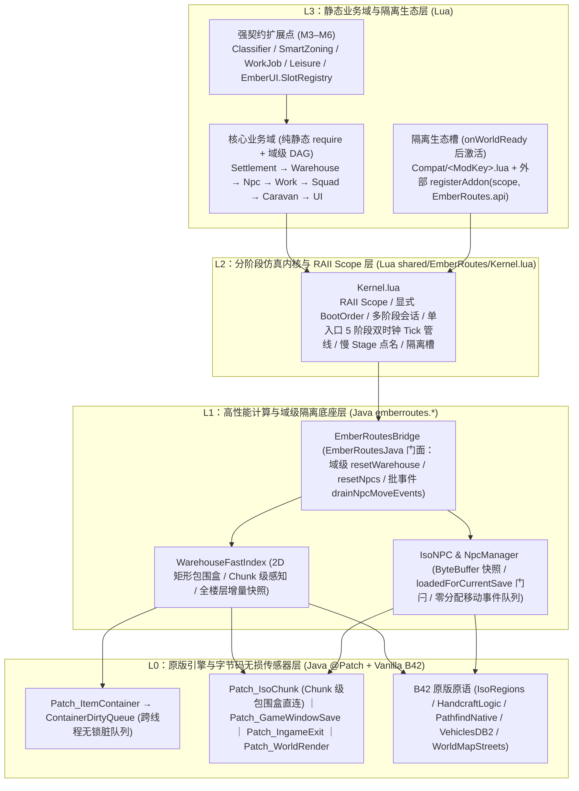
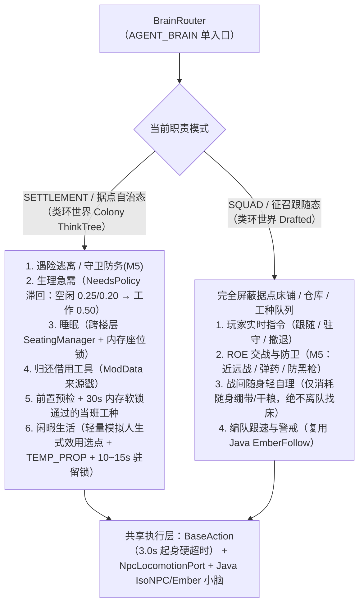

# EmberRoutes V2 全局系统架构与分阶段仿真内核规范

> 日期：2026-11-19｜状态：active｜适用：`EmberRoutesV2` 全生命周期（M1–M6）
> 关联导航：[项目红线 (AGENTS.md)](../AGENTS.md) ｜ [模块路线图与引擎实证 (MODULE_MAP.md)](MODULE_MAP.md) ｜ [V1 复盘与迁移参考 (V1_RETROSPECTIVE_AND_MIGRATION.md)](V1_RETROSPECTIVE_AND_MIGRATION.md)

---

## 1. 架构定位与核心取舍

`EmberRoutesV2` 采用 **「B42 原版引擎原语与无损传感器底座（Java）+ 分域计算桥（Java）+ 分阶段仿真内核与 RAII Scope（Lua）+ 强契约扩展点 + 前置 UI 框架 `EmberUI`」** 的混合架构。设计上严格区分两种“兼容”边界：

1. **内部历史包袱零兼容（严令禁止）**：严禁保留旧版存档格式迁移分支、旧接口别名、转发壳或双轨 fallback（见 [AGENTS.md](../AGENTS.md)）。
2. **外部工坊模组生态高兼容（核心架构目标）**：通过**底层原件守恒**天然兼容绝大多数内容型模组，并通过 **RAII 可逆副作用 `Scope` + 隔离式 `Compat / Addon` 槽 + 少量强契约扩展点**解决高阶机制/UI 模组冲突与社区附属子模组扩展。

### 为什么演进为「分阶段仿真内核 + 静态模块」而非保留字符串 DI 微插件容器？

| 维度 | 淘汰方案：通用字符串 DI 插件容器 | 正式架构：B42 分阶段仿真内核 + 静态模块 | 取舍依据（B42 引擎与代码实证） |
| :--- | :--- | :--- | :--- |
| **内部模块依赖** | `provide/inject` 字符串查找与原生 `require` 双轨并存 | **100% 原生静态 `require` + 域级 DAG 门禁**（[check_arch.py](../tools/check_arch.py)） | 本模组为单人单会话、不支持运行期热拔核心服务；静态 `require` 零开销、IDE 类型/跳转完备且环检测 100% 静态可视 |
| **引擎生命周期** | 单阶段 `boot()` 混绑 `OnInitGlobalModData` 与 `OnGameStart` | **显式 4 阶段**：`onModDataReady`（后台加载线程仅读 ModData）→ `onWorldReady`（主线程 `OnGameStart` 仅跑 1 次）→ `onPlayerCreated`（同档死亡重生）→ `onTeardown`（`Patch_IngameExit` + `OnPreMapLoad` / `OnMainMenuEnter`） | B42 实证：`OnInitGlobalModData` 跑在 `GameLoadingState` 后台线程且无 `currentCell`；`IngameState.exit()` 在 `OnMainMenuEnter` 前就重建了 Lua VM |
| **帧循环与区块感知** | 各模块散装 `Events.OnTick` 与逐格 `LoadGridsquare` Lua 回调 | **单入口 5 阶段双时钟 Tick 管线**（`WORLD_SYNC → PHYSICS_MOVE → SOFT_LOCKS → AGENT_BRAIN → MACRO_WORLD`）+ **Java `Patch_IsoChunk` Chunk 级包围盒直连** | 保证 M3–M6 同帧因果序、消灭低频任务共振掉帧与开车每秒数千次跨 Kahlua 往返；双时钟（`frameTick` vs `simTime`）杜绝 3x 倍速超时错乱 |
| **副作用回收与安全** | `Scope` 回收 + 引用计数锁 + 安全 `wrap` | **完整保留并去耦为独立一等原语 `Scope`**（含脱机 `standalone` 兼容 `preview-ui.ps1`） | 根治 UI 开关泄漏、第三方模组互踩 `disableWorldMenu` 与撕裂 Hook 链 |

---

## 2. 系统四层拓扑与 Java ↔ Lua 职责切分



### 跨语言硬性边界

1. **L0 字节码补丁层（根包 `emberroutes.Patch_*`）**：
   - 因 ZombieBuddy `PatchEngine.collectPatches` 仅按根包精确匹配扫描，**所有 `Patch_*` 类必须严格留在根包 `emberroutes` 下**；只做最薄的无损钩子（`@Patch.OnEnter` / `@Patch.OnExit`），严禁修改原版方法返回值或吞掉原版调用（如 [Patch_ItemContainer.java](../java-src/src/main/java/emberroutes/Patch_ItemContainer.java)、[Patch_IsoChunk.java](../java-src/src/main/java/emberroutes/Patch_IsoChunk.java)、[Patch_GameWindowSave.java](../java-src/src/main/java/emberroutes/Patch_GameWindowSave.java)、[Patch_IngameExit.java](../java-src/src/main/java/emberroutes/Patch_IngameExit.java)、[Patch_WorldRender.java](../java-src/src/main/java/emberroutes/Patch_WorldRender.java)）；
   - 因区块流式加载可能在后台线程触发 `ItemContainer.load`，补丁内**严禁触碰非线程安全的 `KahluaTable` 或调用 Lua 闭包**，只能写入并发无锁结构（如 [ContainerDirtyQueue.java](../java-src/src/main/java/emberroutes/warehouse/ContainerDirtyQueue.java)）；
   - Gradle 的 ArchUnit 测试（[ArchitectureBoundaryTest.java](../java-src/src/test/java/emberroutes/ArchitectureBoundaryTest.java)）强制检查全部生产 `Patch_*` 类及其内部类不直接依赖 `se.krka.kahlua..`。
2. **L1 Java 底座层（`emberroutes.*`）**：
   - 独占承担大规模格点遍历、Chunk 级包围盒过滤、全楼层世界容器聚合（[WarehouseFastIndex.java](../java-src/src/main/java/emberroutes/warehouse/WarehouseFastIndex.java)）、`IsoRegions` 屋顶封闭查询（[EmberRoutesBridge.java](../java-src/src/main/java/emberroutes/EmberRoutesBridge.java)）、C++ `PathfindNative` 路径拉直、`ByteBuffer` 实体存读档与移动状态跃迁批队列；
   - **域级隔离重置与防空写门闩**：严禁单个业务域调用全局 `EmberRoutesJava.reset()` 误杀其他域（仓储重挂载只调 `resetWarehouse()`，NPC 域只调 `resetNpcs()`）；任何二进制快照存盘（如 [NpcManager.java](../java-src/src/main/java/emberroutes/npc/NpcManager.java) `saveAllToDisk()`）必须校验 `loadedForCurrentSave == true`，杜绝 B42 存档跨版本升级在 `GameLoadingState` 早期触发 `GameWindow.save(true)` 时空写覆盖存档；
   - **统一「Push-to-Queue + Single-Drain」跨语言事件协议**：Java→Lua 高频热事件（容器脏格、NPC 移动终结事件）一律在 Java 侧入队，由 Lua 帧管线单次批拉取，无事件时返回 `null`，**热路径 0 `KahluaTable` 分配**。
3. **L2 分阶段仿真内核与 L3 静态业务域（Lua）**：
   - 内部核心域 100% 静态 `require`，由 [check_arch.py](../tools/check_arch.py) 强制执行**域级单向 DAG**（`Settlement(10) → Warehouse(20) → Npc(30) → Work(40) → Squad(50) → Caravan(60) → UI(70) → Compat(80)`）与**循环 `require` 环检测**；
   - 对外仅通过只读门面 `EmberRoutes.api` 暴露收敛的公开能力，绝不把内部模块表混成扁平全局 DI 字典。

---

## 3. 分阶段仿真内核与 RAII Scope 契约规范

内核位于 [Kernel.lua](../Contents/mods/EmberRoutes/42/media/lua/shared/EmberRoutes/Kernel.lua)（零业务依赖、置于 `shared/` 保证任意 Mod 加载顺序皆可安全 `require`），唯一引擎事件总装配位于 [Boot.lua](../Contents/mods/EmberRoutes/42/media/lua/client/EmberRoutes/Boot.lua)。

### 3.1 RAII `Scope` 核心原语签名与语义

| 原语 | 职责与严格契约 |
| :--- | :--- |
| `Kernel.scope(label)` | 派生一个可逆作用域：会话运行期挂于根 `worldScope` 下级联销毁；未进档或离线渲染环境（如 `./tools/preview-ui.ps1`）自动返回独立 `standalone` Scope。 |
| `scope:effect(fn)` / `scope:defer(cleanupFn)` | 注册可逆副作用；销毁时严格按 **LIFO（后进先出）** 顺序独立 `pcall` 容错执行，单点失败绝不阻断后续资源释放。 |
| `scope:on(eventObj, handler)` | 仅用于低频/交互事件（如 `OnFillWorldObjectContextMenu`）；**严禁绕过单入口管线和 `Patch_IsoChunk` 注册 `OnTick / OnTickEvenPaused / LoadGridsquare / ReuseGridsquare`**（由 [check_arch.py](../tools/check_arch.py) 静态拦截）。 |
| `scope:subscribe(store, fn)` | 适配数据层监听（如 [SettlementStore.lua](../Contents/mods/EmberRoutes/42/media/lua/shared/EmberRoutes/Settlement/SettlementStore.lua)），自动托管幂等解绑闭包。 |
| `scope:acquireGlobalFlag(tbl, key, val)` | **全局状态引用计数守卫**：针对 `ISWorldObjectContextMenu.disableWorldMenu` 等多模组共享全局布尔位，首次获取快照外部原始值，仅当所有持有作用域均释放后才还原原始值，且不使用全局 `next()`（兼容 B42 Kahlua2）。 |
| `scope:wrap(tbl, method, factory)` | **安全方法包装器**：卸载时若 `tbl[method]` 仍为本包装函数则直接恢复原函数；若已被后加载模组二次包装，则切换内部 `active = false` 旁路直通原函数，绝不撕裂他模组调用链。 |

### 3.2 多阶段生命周期与单入口 5 阶段双时钟 Tick 管线

1. **静态加载期（Lua File Load）**：各核心模块调用 `Kernel.registerModule(def)`（按 `id` 幂等覆盖，兼容开发期 F11 重载），[Boot.lua](../Contents/mods/EmberRoutes/42/media/lua/client/EmberRoutes/Boot.lua) 通过 `Kernel.setBootOrder({...})` 声明唯一权威启动数组，并通过 `Kernel.subscribeOnce` 挂接唯一一套顶层引擎事件（全模组仅 **1 个 `OnTick`**、**1 个 `OnTickEvenPaused`**、**0 个 Lua 侧 `LoadGridsquare / ReuseGridsquare`**）。
2. **`onModDataReady(scope, isNewGame)`（对应 `OnInitGlobalModData`）**：
   - 运行在 `GameLoadingState` 后台加载线程，**严禁触碰 `IsoCell`、`IsoPlayer`、渲染或 UI**，只做纯 `ModData` 读取与结构初始化。
3. **`onWorldReady(scope)`（对应主线程 `OnGameStart`，幂等仅执行 1 次）**：
   - 因 `IngameState` 在 `OnGameStart` 之前已执行完初始出生点的 `processAllLoadGridSquare()`，各域必须在此主动完成初始挂载（如 `WarehouseWatcher` 调 `SettlementStore.reconcileAndMountAll()`，`NpcRuntime` 调 `loadNpcsFromSave()`）；
   - 按 `BootOrder` 构建 5 阶段紧凑帧管线数组，最后依次隔离激活全部 `Compat` 与外部 `Addon`。
4. **`onPlayerCreated(playerIndex, player)`（对应 `OnCreatePlayer`）**：
   - 支持同存档主角死亡后“新建角色”（不触发 `OnMainMenuEnter` 也不触发 `OnGameStart`）；**全库红线：严禁任何模块跨帧缓存 `IsoPlayer` 局部对象引用**。
5. **单入口 5 阶段确定性双时钟 Tick 管线（`Kernel.dispatchTick`）**：
   - 固定因果顺序：`WORLD_SYNC` → `PHYSICS_MOVE` → `SOFT_LOCKS` → `AGENT_BRAIN` → `MACRO_WORLD`；
   - 统一注入双时钟 `(frameTick, dtSim, simTime)`：
     - `frameTick`（来自 B42 `numberTicks`）：**仅用于 CPU 分帧轮转（每帧 1–2 个 NPC）与低频错峰相位（`frameTick % N == offset`）**，防止同帧共振掉帧；
     - `dtSim / simTime`（来自 `getGameTime():getGameWorldSecondsSinceLastUpdate()`）：**用于一切玩法超时、30s 软锁 TTL、闲暇最小驻留与工具归还延迟**，杜绝 3x/4x 倍速逻辑错乱；
   - 每个处理器独立 `pcall` 容错不连坐后续 Stage，并内置零分配慢 Stage 限流点名报警（`>= 6.0ms`，基于 `EmberRoutesJava.diagnosticTimeNanos()`）；
   - `OnTickEvenPaused` 白名单仅允许 `O(1)` 判空的仓储脏队列排空，严禁塞入任何 AI 或扫描逻辑。
6. **会话卸载（`Patch_IngameExit` + `OnPreMapLoad` + `OnMainMenuEnter`）**：
   - B42 实证：`IngameState.exit()` 会在进入主菜单前重建整个 Kahlua VM，因此绝不将必须落盘的关键清理寄托在根会话 Lua `defer` 上；
   - Java 静态单例由 [Patch_IngameExit.java](../java-src/src/main/java/emberroutes/Patch_IngameExit.java) 在 `IngameState.exit()` 结束时立即清空释放已死 `IsoCell` 引用，`OnPreMapLoad` 与 `OnMainMenuEnter` 调 `Kernel.teardown()` 幂等兜底。

### 3.3 生命周期闭环三要素映射表

| 子系统 / 资源类型 | 1. 创建 / 挂载端（Mount & Claim） | 2. 正常释放 / 裁剪端（Normal Release） | 3. 异常打断 / 卸载 / 读档端（Interrupt & Teardown） |
| :--- | :--- | :--- | :--- |
| **存档会话与管线**<br>（[Kernel.lua](../Contents/mods/EmberRoutes/42/media/lua/shared/EmberRoutes/Kernel.lua)、[Boot.lua](../Contents/mods/EmberRoutes/42/media/lua/client/EmberRoutes/Boot.lua)） | `OnInitGlobalModData` 跑 `onModDataReady`；主线程 `OnGameStart` 按显式清单一次跑完 `onWorldReady`、冻结 5 阶段管线并激活 `Compat / Addon` | 单 Stage 异常经 `pcall` 限流隔离不阻断后续 Stage；外部 `Compat` 停用调用独立 `scope:dispose()` | [Patch_IngameExit.java](../java-src/src/main/java/emberroutes/Patch_IngameExit.java) 立即释放全部 Java 域静态态；`OnPreMapLoad / OnMainMenuEnter` 触发 `Kernel.teardown()` 幂等兜底 |
| **据点领地与容器索引**<br>（[SettlementStore.lua](../Contents/mods/EmberRoutes/42/media/lua/shared/EmberRoutes/Settlement/SettlementStore.lua)、[WarehouseFastIndex.java](../java-src/src/main/java/emberroutes/warehouse/WarehouseFastIndex.java)） | `commitSettlement` 写 `ModData` 并调 `syncSettlementAreas` 扫描领地内 `minLevel..maxLevel` 全楼层容器；运行期由 [Patch_IsoChunk.java](../java-src/src/main/java/emberroutes/Patch_IsoChunk.java) Chunk 级包围盒直连 | `trimTerritory` 裁剪移出格贡献；`deleteSettlement` 调 `invalidateSettlementWarehouse`；重扫只调 `resetWarehouse()` 绝不波及 NPC | 区块回收经 `Patch_IsoChunk` 标为 `OFFLINE_CACHED` 保留最后快照；读档由 `onWorldReady` 重挂载 |
| **UI 窗口与全局开关**<br>（[ZoneEditorPanel.lua](../Contents/mods/EmberRoutes/42/media/lua/client/EmberRoutes/UI/ZoneEditorPanel.lua)、[DebugWarehousePanel.lua](../Contents/mods/EmberRoutes/42/media/lua/client/EmberRoutes/UI/DebugWarehousePanel.lua)） | `Panel.open` 创建 `Kernel.scope(...)`（离线预览自动降级 `standalone`），经 `acquireGlobalFlag` 锁 `disableWorldMenu` 并由 `EmberUI.PageLifecycle.attachExternalScope` 双向绑定 | 玩家点击保存/取消或按 `ESC` 调 `close()`，对称释放订阅并按引用计数恢复 `disableWorldMenu` | 面板回调异常或会话拆卸时父级 `worldScope:dispose()` 兜底强杀所有存活子 `scope`，确保 `disableWorldMenu` 绝不卡死 |
| **NPC 躯壳、批移动事件与二进制快照**<br>（[NpcManager.java](../java-src/src/main/java/emberroutes/npc/NpcManager.java)、[NpcRuntime.lua](../Contents/mods/EmberRoutes/42/media/lua/client/EmberRoutes/Npc/NpcRuntime.lua)、[NpcLocomotionPort.lua](../Contents/mods/EmberRoutes/42/media/lua/client/EmberRoutes/Npc/NpcLocomotionPort.lua)） | `onWorldReady` 唯一一次 `loadNpcsFromSave()`（置 `loadedForCurrentSave = true`）；`PHYSICS_MOVE` 先推物理再 `drainNpcMoveEvents()` 零分配批消费；M3 借用工具写 `ModData` 来源戳 | 离屏经 `phaseOut` 存内存快照，回归由 `Patch_IsoChunk` 自动 `phaseIn`；死亡交接 `IsoDeadBody` 后退役 | `saveAllToDisk()` 强检 `loadedForCurrentSave` 杜绝版本转换空写覆写；仅在 `GameWindow.save` 与 `phaseOut` 写快照（临时文件原子替换） |

---

## 4. 僵毁三层模组兼容体系（Workshop Compatibility Architecture）

按第三方模组的侵入程度分层治理：

### 4.1 第一层：90% 内容型模组「零配置天然兼容」（枪械、食物、车辆、地图、家具包）

1. **原件实例 100% 守恒**：全链路操作真实 `InventoryItem`、`ItemContainer` 与 `BaseVehicle` 实例，保留原 `id`、耐久、流体、配件与第三方模组写入的 `ModData`；严禁“删物按 `fullType` 重刷”或触碰封闭的 `item:getAttributes()`。
2. **数据驱动的分类规则链（替代硬编码字符串）**：
   - [WarehouseFastIndex.java](../java-src/src/main/java/emberroutes/warehouse/WarehouseFastIndex.java) 遵循 **「Lua/外部插件显式覆盖表优先 $\rightarrow$ B42 原版 `ItemTag` / `Food` / `FluidContainer` 属性推导 $\rightarrow$ `Category / DisplayCategory` 兜底」**；
   - 极端非标物品由轻量 `Compat` 注入 `registerCategoryOverride`，无需改动 Java 核心。
3. **复用原版世界与配方语义**：工坊制作走原版 `HandcraftLogic / CraftLogic`，商队路网读 `WorldMapStreets`，真车虚实转换走 `VehiclesDB2` + `BaseVehicle.save(ByteBuffer)`。

### 4.2 第二层：8% 机制 / UI / 动作冲突模组「隔离式 `Compat` 槽适配」

1. **主干零污染铁律**：核心业务目录（`Settlement`、`Warehouse`、`Npc`、`Work`、`Squad`、`Caravan`、`UI`）**严禁出现任何 `getActivatedMods()` 第三方模组判断**（由 [check_arch.py](../tools/check_arch.py) 强制拦截）。
2. **`IsoNPC` 全局上下文自卫（防误伤第三方玩家模组）**：
   - `IsoNPC extends IsoPlayer` 恒返 `isLocalPlayer() == false`，严禁写入 `IsoPlayer.players[]`；
   - `IsoNPC.update()` 在 `try / finally` 中保存并还原 `IsoPlayer.getInstance()` 与 `IsoCamera.getCameraCharacter()`；
   - 通过 [HaloTextGuard.lua](../Contents/mods/EmberRoutes/42/media/lua/client/EmberRoutes/Compat/HaloTextGuard.lua)（`Kernel.registerCompat` + `scope:wrap`）统一过滤非本地角色飘字。
3. **独立 `Compat/<ModKey>.lua` 规范**：
   - 使用 `Kernel.registerCompat({ id, when, apply })` 注册，**强制仅在全部核心域 `onWorldReady` 后执行、强制 `pcall` 熔断隔离、强制独立 `scope`**，任何包装原版函数一律走 `scope:wrap`。

### 4.3 第三层：2% 社区附属子模组「强契约扩展点 + 安全逃生口」

不暴露内部实现依赖图；对外提供 **5 个强契约扩展点**（随 M3–M4 逐级按需开放，带参数校验与 `scope` 自动回收）以及 1 个隔离逃生口 `EmberRoutes.registerAddon({ id, when, apply(scope, EmberRoutes.api) })`：

| 扩展域 | 标准契约接口（随 M1–M4 逐级开放） | 社区子模组典型用途 |
| :--- | :--- | :--- |
| **仓储分类** | `EmberRoutesJava.registerCategoryOverride` / 后续 `Warehouse.registerClassifier` | 为大型综合模组自定义物资分类节点 |
| **智能分拣 (M3)** | `SmartZoning.registerPreset(id, def)` | 为模组专属容器（军火柜、酿造桶、医疗箱）配置自动分拣预设 |
| **生产工种 (M4)** | `Work.registerJob(def)`（强约束 `id / probe / createAction / diagnose`） | 新增自定义 NPC 工种（酿酒、拆车、无线电值守） |
| **生活与姿态 (M3)** | `Npc.registerLeisure(def)` / `Npc.registerFurnitureAdapter(def)` | 适配第三方家具包坐卧锚点或新增闲暇表现 |
| **据点界面 (M4)** | **直接复用 `EmberUI.SlotRegistry`**（`onWorldReady` 注入能力位、`onTeardown` 清空） | 在据点管理面板注入专属页签与卡片（不重复造第二套 UI 注册表） |

---

## 5. 持久层与瞬态层两层状态架构

严格执行 [AGENTS.md](../AGENTS.md) 性能与简洁性红线，**废除一切持久态任务锁账本**：

### 5.1 持久层（Persistent Layer —— 跨存档保留，开放 Schema）

1. **宏观规则与业务档案（`ModData`）**：
   - 仅存储玩家划定的据点几何（`EmberRoutes.Settlements`）、容器过滤配置、工坊维持库存双阈值策略、NPC 名册元数据与跨聚落易物合同；
   - **开放字符串防崩档契约**：所有持久字段中的物品类型、标签、工种 ID 一律存储纯字符串，严禁读档封闭枚举 `assert` 崩溃。
2. **离屏与存盘实体快照（`ByteBuffer`）**：
   - 在场活跃 `IsoNPC` 与真实商队载具在日常运行与后台区块热存（Hotsave）期间 **0 序列化开销**；
   - 仅在区块卸载转离屏（`phaseOut`）与正常退出/保存游戏（`GameWindow.save`，且强制验过 `loadedForCurrentSave` 门闩）两个确定性时机通过临时文件原子替换生成二进制原件快照。

### 5.2 瞬态层（Transient Layer —— 纯内存运行，读档零包袱重建）

- **世界容器增量索引**：`WarehouseFastIndex` 与 `ContainerDirtyQueue` 纯内存维护，进档由持久据点矩形实时重扫构建；
- **NPC 微观执行态**：单点身体控制队列、寻路折线、批移动终结事件队列、`BaseAction` 计时进度、`30s` 软预约锁（以 `simTime` 计时）、`TEMP_PROP` 闲暇道具全部纯内存驻留，打断或重载即天然释放，**永不产生死锁烂账**；
- **借用工具自动归回**：唯一允许落于物品自身的轻量标记是在真实工具 `InventoryItem:getModData()` 写入借出来源容器键，NPC 空闲自检时直接寻址归还并置 `nil`。

### 5.3 NPC 双大脑分层决策架构（M3：`BrainRouter`：`SETTLEMENT` vs `SQUAD`）

从 M3（`EMB-12`）起，每名 `IsoNPC` 在 `AGENT_BRAIN` 阶段的决策层摒弃 V1“多状态机各自抢占”与“纯通用效用曲线”的混乱模型，采用 **「顶层职责硬分叉（`BrainRouter`）+ 据点确定性优先级树 + 轻量效用闲暇 + 共享执行层」**：



- **`SETTLEMENT ↔ SQUAD` 零烂账无缝切换**：切换只修改纯内存模式枚举，并立即打断当前 `BaseAction`、释放内存 `30s` 软预约与座位锁；所有实物与借出工具完全依赖背包真实原件及 `InventoryItem:getModData()` 来源戳自愈。
- **域级 DAG 天然吻合**：`Npc(30)` 托管 `BrainRouter`、`BaseAction` 与 `NeedsPolicy`；`Work(40)` 仅向 `SettlementBrain` 注册工种；`Squad(50)`（M5）向 `BrainRouter` 的 `SQUAD` 分支挂接 ROE 与编队逻辑（M3 阶段 `SQUAD` 先以极简短路对接现有 Java `EmberFollowController`）。

---

## 6. 前置 `EmberUI` 框架契约与 UI 验证门禁规范

1. **统一前端底座（严禁自研/回迁重复组件库）**：所有正式界面一律基于前置模组 `EmberUI`（Mod ID：`EmberUI`，`v1.1.0+`）构建，界面扩展槽位直接收敛到 `EmberUI.SlotRegistry`；已在 `mod.info` 声明 `require=\ZombieBuddy,\EmberUI`。
2. **所有权作用域**：每个可开关窗口/页签打开时创建 `Kernel.scope(name)` 并通过 `EmberUI.PageLifecycle.attachExternalScope(page, scope)` 双向绑定销毁；离线预览器（`./tools/preview-ui.ps1`）自动走 `standalone` Scope，无需模拟完整进档流程。
3. **严格零 GC 渲染流水线**：数据变更期置 `dirty = true` $\rightarrow$ 按需投影期经 `EmberUI.CachedList.reconcile` 原地刷新 $\rightarrow$ 绘制期 `prerender / render` 100% 只读预计算标量，0 表分配、0 世界方块扫描、0 JNI 动态测量。
4. **双语与原生视觉双门禁**：CN/EN 100% 成对同步，仅用 `%1..%9` 位置占位符；每次改动必过 [build.ps1](../build.ps1)，UI 布局改动必跑 [preview-ui.ps1](../tools/preview-ui.ps1) 并回读截图核验。

---

## 7. 物理目录组织原则与静态门禁

目录组织遵循 **「拒绝全量平铺 + 拒绝机械套壳 + 随维护复杂度自然拆分 + 严格域级 DAG」**：

1. **核心入口精简留根，业务代码按领域归类**：Java `Main.java` / `EmberRoutesBridge.java` / `Patch_*.java` 留根包，域代码按 `warehouse / npc / caravan / llm` 分包；Lua `Kernel.lua` / `Boot.lua` 留根，域代码按 `Settlement / Warehouse / Npc / Work / Squad / Caravan / UI / Compat` 归类。
2. **只守真正防架构腐化的硬边界（由 [check_arch.py](../tools/check_arch.py) 与 [ArchitectureBoundaryTest.java](../java-src/src/test/java/emberroutes/ArchitectureBoundaryTest.java) 每次构建自动守卫）**：
   - `shared` 严禁引用 `client`；`Kernel.lua` 严禁引用任何业务域或 `EmberUI`；
   - 核心业务域严禁反向依赖高层域（严格 DAG 阶序）或成环 `require`，严禁引用 `UI` / `Compat` / `getActivatedMods`；
   - 严禁业务域直调总 `EmberRoutesJava.reset()`，严禁绕过 `Kernel` 管线与 `Patch_IsoChunk` 注册热事件；
   - Java 全部 `Patch_*` 必须留根包且不直接依赖 `se.krka.kahlua..`，Java 领域子包不反向依赖 `EmberRoutesBridge` 或 `Patch_*`。

```text
EmberRoutesV2/
├── AGENTS.md                                           # L1 项目最高红线与工程纪律
├── docs/
│   ├── ARCHITECTURE.md                                 # L2 全局系统架构与分阶段仿真内核规范（本文档）
│   ├── MODULE_MAP.md                                   # L2 模块路线图与 B42 引擎实证基线
│   └── V1_RETROSPECTIVE_AND_MIGRATION.md               # L2 V1 遗产盘点、踩坑台账与缺陷根治对照
│
├── java-src/src/main/java/emberroutes/
│   ├── Main.java                                       # ZombieBuddy 入口（织入根包 @Patch + 暴露桥接门面）
│   ├── EmberRoutesBridge.java                          # Lua 静态桥接门面（域级 reset* / 批事件 drain* / 诊断时钟）
│   ├── Patch_*.java                                    # L0 字节码无损传感器（根包铁律：ItemContainer / IsoChunk / GameWindowSave / IngameExit / WorldRender）
│   ├── warehouse/                                      # 脏队列、Chunk 包围盒感知、2D 空间查表与增量仓储索引
│   ├── npc/                                            # [M2+] IsoNPC 躯壳、ByteBuffer 快照、防空写门闩与批移动事件队列
│   ├── caravan/                                        # [M6 按需] 路网拓扑与 VehiclesDB2 真车虚实封装
│   └── llm/                                            # [M5 按需] 独立大模型通信与配置桥
│
└── Contents/mods/EmberRoutes/42/media/lua/
    ├── shared/EmberRoutes/
    │   ├── Kernel.lua                                  # 分阶段仿真内核 + RAII Scope + 5 阶段双时钟 Tick 管线 + 隔离槽
    │   ├── Settlement/                                 # 据点几何算法（SettlementGeometry）与持久化（SettlementStore）
    │   ├── Warehouse/                                  # [M1–M3 按需] 分类规则与 SmartZoning 容器过滤纯逻辑
    │   └── Work/                                       # [M4 按需] 工种强契约注册表与库存双阈值配置模型
    │
    └── client/EmberRoutes/
        ├── Boot.lua                                    # 唯一显式启动顺序清单与引擎顶层事件挂接
        ├── Warehouse/                                  # 仓储 WORLD_SYNC 节拍与暂停态 O(1) 脏排空入口
        ├── Npc/                                        # [M2–M3] 躯壳管理、零分配批移动端口、BrainRouter / SettlementBrain / BaseAction
        ├── Work/                                       # [M4] 伐木 / 农耕 / 烹饪 / 工坊工种实现
        ├── Squad/                                      # [M5 按需] SquadBrain（随从编队 / 守卫 ROE / 战间随身自理）
        ├── UI/                                         # 基于 EmberUI 的界面面板（扩展页签直复用 EmberUI.SlotRegistry）
        └── Compat/                                     # 第三方工坊模组隔离适配槽（主干业务零引用）
```
