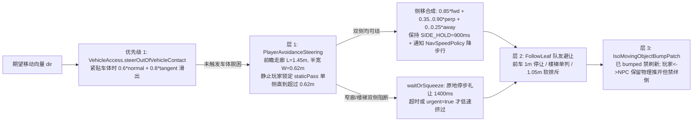

# 03 底层物理运动、3D 寻路、三层玩家避让与原子任务执行体系

> 覆盖源码：`npcfw/nav/*`（8 类）、`npcfw/utils/NPCMovementUtil.java`、`npcfw/inventory/NPCContainerAccess.java`、`npcfw/tasks/*`（14 类），及 `IsoNPC`、`FollowLeaf`、`IsoMovingObjectBumpPatch`、`DoorToggleObserverPatch` 交互链路。

---

## 1. 底层物理运动驱动（`NPCMovementUtil` + `IsoNPC`）

`IsoNPC` 继承原生 `IsoPlayer`（`isNpc() == true`，附身返回 `false`），并非直接修改坐标瞬移，而是同步驱动原版 **`playerMoveDir`** 与 ECS **`AIComponent.getHumanControlVars()`（`AIBrainPlayerControlVars`）**。

### 1.1 “零滑步 / 零过冲”四件套闭环
1. **`manualMovement` 8 步安全流水线**：
   - 先清空 `manualMovementClamp`；若正处于翻栏/翻窗/翻高墙/开窗状态（`isClimbing`），直接放行绝不中断；
   - 经 `PlayerAvoidanceSteering.adjust(npc, dir, urgent)` 做**载具脱困 + 真人玩家避让转向**；返回空或零向量触发 `avoidance-yield` 原地停步；
   - 安全否决门控：非楼梯安全区且脚下为可导航地面时，必须通过前方 `0.65F`（精确逼近时收缩为 `min(0.65F, distToTarget)`）可通行或末端为可翻低栅栏检测，否则触发 `safety-veto` 立即停步；
   - `cancelVanillaPath == true` 时取消原版 `PathFindBehavior2` 防两套移动抢方向；楼梯安全区内强制 `NavSpeedPolicy.forceWalk`。
2. **渲染角 Strafe 局部坐标旋转**：
   - 写入 `playerMoveDir` 与 `vars.justMoved = true` 后，读取骨骼实际渲染朝向 `animPlayer.getRenderedAngle()`（异常回退 `getDirectionAngleRadians()`），将单位移动矢量 `(adjusted.x, -adjusted.y)` 逆旋为角色局部系：
     $$\text{strafeX} = m_x \cos\theta - m_y \sin\theta,\quad \text{strafeY} = m_x \sin\theta + m_y \cos\theta$$
   - 配合 `IsoPlayerPatch`（阻止 `updateInternal2` 第 8/9 分支用键鼠或朝向强写 `playerMoveDir`）与 `IsoPlayerIsJustMovedPatch`（`playerMoveDir` 非零时恒返 `true`），使瞄准侧移/倒走完全贴合骨骼混合树。
3. **根位移距离截断 `getDeferredMovement`（核心防过冲）**：
   - 开启精确逼近 `manualMovementClamp` 或处于原版坐家具/上车路径 `PathFindBehavior2` 时，在 `IsoNPC.getDeferredMovement` 覆写中计算 `clampDeferredMovement`：**若本帧引擎根位移模长大于目标剩余距离，直接将根位移缩至精确剩余距离（`distSq <= 1e-6` 时归零）**，根除精确点来回震荡过冲。
4. **队列步速同步 `calculateWalkSpeed()`**：
   - 先复用 `super.calculateWalkSpeed()` 计算原版负重/伤病/技能步速；
   - 若为已链接跟随同伴且在同楼层 5 格内，按状态对齐领队 `WalkSpeed / RunSpeed / StrafeSpeed`（CQB 潜行乘 `formationPaceScale`），确保编队齐步走不掉队。

---

## 2. 自研 3D 网格 A\*、全局限流与门窗纪律（`npcfw/nav/*`）

### 2.1 分工原则与 3D `NavGrid` 代价矩阵
- 日常所有移动/跟随/作业/容器可达校验统一走自研 **`NPCPathfinder + NavGrid + NavPath + NavMover`**；原版 `PathFindBehavior2` 仅保留给坐家具、上车最后两步的动画贴合，并且 `NavGrid.lineBlocked()` 直接调用原生 `PolygonalMap2.instance.lineClearCollide(..., ignoreVehicle, ignoreDoors, bDoClosed)`（放行从紧贴车辆驶离的出口射线）。
- **对角防切角**：斜向移动要求两个正交中间格可走、4 条邻边均非 `cornerWallBlocked`（含任何门/窗/栏交互边），且走廊不能与任何车辆 `polyPlusRadius`（半宽 `0.22F`）相交。
- **动态边权模型**：
  | 障碍物 | 代价 | 硬约束 |
  |---|---|---|
  | 已开门 / 虚空 | `0` | 无 |
  | 关着可开普通门 | **`5`** | 拒绝封板、阻挡、密码锁、无钥匙强锁/室外锁 |
  | 关着可开车库门 | **`40`** | 正交校验，受阻禁行 |
  | 低栅栏 (`Hoppable`) | **`25`** | 仅限 `z == 0`、目标有地板、非楼梯及周邻 1 格 |
  | 已开/无碎玻璃窗 | **`45`** | 仅 `z == 0` 导航地板，无水；**据点居民战时禁翻窗**；避开 `12s` 失败冷却 |
  | 关着可开窗 | **`65`** | 未封板/未永锁，且未上锁或从室内侧开启 |
  | 3D 楼梯边（抽象锚点） | **`50`** | **跳过楼梯中间 3 格**，直接连接「底入口格 ↔ 上层平台格（`Z+1`）」 |
  | 高栅栏 (`TallHoppable`) | **`120`** | 双方无屋顶、无建筑、`z == 0` |

### 2.2 A\* 搜索预算、路径抽稀与防卡死升级（`NPCPathfinder` + `NavPath` + `NavMover`）
- **动态预算与启发式**：`maxNodes = min(9000, 1800 + min(2200, manhattanXY * 18) + |dz| * 2600)`；8 方向 Octile 启发 `10*(dx+dy) - 6*min(dx,dy) + 10*dz`；节点打包进 64-bit `long` 键零装箱查找；相同起终点的失败查询缓存 **`250ms`**。
- **自适应关键检查点抽稀 `NavPath.adaptiveCheckpoints`**：
  - 跨层边两端、交互边两端与终点标为必保 `mandatory` 锚点；同层中间点仅在段长 `<= 3.75F` 且三线宽走廊（中心 + 左右 `±0.18F` 半宽 + 车体包络）完全通畅时贪心拉直。
  - **过冲裁决与楼梯对中**：航点按类别收敛半径（强制点 `0.08F` / 跨层或门前 `0.18F` / 普通 `0.40F`），支持上一帧到本帧扫掠线段穿格判达；上下楼梯时实时施加横向纠偏 `clamp((center - pos) * 1.5, ±0.45)` 防止撞扶手。
- **全局分帧寻路队列（`NavMover.reserveSearchSlot`）**：
  - 全游戏**每 `16ms` 窗口最多允许 1 次 A\* 搜索**（FIFO 队列 + `WeakHashMap` 注册，跨窗未刷新自动过期），避免大群 NPC 同帧寻路掉帧。
- **卡死三级恢复 & 指数退避**：
  - 同层 1 格位移或 60 帧定期重算；无路冷却按 `90 → 180 → 360 → 480` 帧指数退避（`nullStreak >= 3` 上报不可达）。
  - 水平连续 **24 帧**位移 `< 0.4F` 记卡死：`streak 1` 重寻路；`streak 2` 触发 **18 帧左右垂直侧偏脱困**；`streak >= 3` 判不可达停步。
  - 楼梯连续 **120 帧**垂直进度 `< 0.15F` 触发 **24 帧楼梯倒退对中脱困**，冷却按 `30..120` 帧退避重算。

### 2.3 速度档位策略与门禁纪律（`NavSpeedPolicy` + `NavInteract`）
- **`NavSpeedPolicy` 四重抑制跑动**：
  1. 游戏倍速 `GameTime.getTrueMultiplier() > 1.25F` 强制步行；
  2. 前方 `4.75F` 沿线 3×3 含楼梯或 `PlayerAvoidanceSteering.isPrecisionSteering()` 为真时，标记精细区；急转（相邻帧点积 `< 0.82F`）或避让直接触发 **`650ms` 步行保持**；
  3. 直道奔跑要求前方 `2.75F` 跑道全通；下楼口触发一次 **`900ms` 下楼急刹**；仅站在楼梯格内且居中（偏心 `<=0.18`、方向吻合 `>=0.94`）允许特许跑动。
- **`NavInteract` 随手关门纪律（联动 `DoorToggleObserverPatch`）**：
  - 开窗失败 `1500ms` 未进 `OpenWindowState` 或 `4s` 未开开，拉黑该窗 **`12s`**；翻高栅栏按负重 Moodle 算 `5%..80%` 成功率并带 5s/1s 冷却；
  - 将门两侧投影为 `<=0.38`（`-1` 侧）、`>=0.62`（`+1` 侧）与 `[0.12, 0.88] × 0.78` 门洞占用区；观测到有人在 `1400ms` 窗口穿越后，自动追踪同侧随行队友（10m，8s 宽限）与玩家（6m）；待无人占用、无待穿者且过门沉降 `>= 500ms` 后，由 `<= 1.65m` 内的队友转身反手 `ToggleDoor` 关门！

---

## 3. 三层正交玩家避让体系（`PlayerAvoidanceSteering` 核心参考）

ProjectRemnants 将“不挡玩家路、不撞翻玩家、不互相卡死”拆解为**互不重叠的三层机制**，是 V2 解决「NPC 撞倒玩家且不避让」的最核心范本：

### 3.1 第一层：`PlayerAvoidanceSteering.adjust(npc, desiredDir, urgent)` 完整参数与状态机
1. **载具优先脱困**：优先检测 `isCollidedWithVehicle()` 或是否在车辆多边形内，按 `0.6*法向 + 0.8*切向`（切向按对象哈希定侧防摇摆）优先滑离车体。
2. **走廊阻挡框检测 `blocksCorridor`**：
   - `LOOKAHEAD = 1.45F`（前向投影 `[-0.05F, 1.45F]`，距离上限 `1.45m`）
   - `CORRIDOR_HALF_WIDTH = 0.62F`（横向垂直偏移 `<= 0.62m`）
   - **重要工程注意（原版特例）**：ProjectRemnants 的 `isRequiredContactTarget` 在 `order == FOLLOW && followTarget == humanPlayer` 时**直接豁免了正在跟随的队长**（依靠 `FollowLeaf` 停走迟滞与后移槽位防止撞队长，仅在非豁免、换任务、交叉穿行他人时绕行）。若在多场景（包含跟随交叉走位或战斗走打时）需要全场景避让玩家，应视当前距离与目标意图精细判断是否放行，并在**战斗平移路径也必须统一经过此避让管线**！
3. **静止玩家锁定绕行（`staticPass` 防锯齿抖动根治机制）**：
   - 当检测到的真人玩家处于静止态（`!isJustMoved() && playerMoveDir.lenSq <= 4e-4F`）时，立即锁存初始基准前进方向 `(passDirectionX, passDirectionY)`；
   - 绕行起步后即便玩家短暂离开前方 1.45m 矩形走廊，`continueStaticPass` 依然保持基于锁存方向的绕行矢量，直到满足任一释放条件：NPC 沿锁存方向越过玩家 **`>= 0.62F`（`STATIC_PASS_RELEASE_FORWARD`）**、距玩家超 `3.0F`、玩家换层/死亡、或 NPC 新意愿方向与原锁存方向点积 `< 0.15F`。
4. **绕行向量合成与双侧安全校验**：
   - 紧迫系数 `closeness = clamp((1.45 - dist) / 0.97, 0.0, 1.0)`；
   - `detour = normalize(0.85 * baseDir + (0.35 + 0.55 * closeness) * perp(side) + 0.25 * closeness * away)`；
   - 安全验证 `isSafeDetour`：沿着绕行方向探测 **`PROBE_DISTANCE = 0.95F`** 必须不撞墙/家具/车，且线段到玩家的最近距离平方 `>= 0.48² (0.2304F)`（若原本已侵入 `0.48m` 内，则要求探测终点严格更远离玩家 `> distSq + 0.02F`）；
   - 双侧皆通且过 **`SIDE_HOLD_MS = 900ms`** 后，按 `0.55F / 1.15F` 两段净空分选更空一侧；锁定期间不左右横跳。
5. **窄道/楼梯停让与超时挤过 `waitOrSqueeze`**：
   - 站在楼梯或双侧均被墙壁堵死（1 格窄廊/门口）时：非 `urgent` 模式先返回零向量让 NPC 原地礼让 **`YIELD_BEFORE_SQUEEZE_MS = 1400ms`**，超过 1.4 秒玩家仍堵在通道里则放行原方向低速挤过防死锁；
   - 凡触发过避让，写入 **`PRECISION_HOLD_MS = 450ms`** 标记联动 `NavSpeedPolicy` 强制降为步行。

### 3.2 第二层（队友队列）与第三层（碰撞补丁兜底）
- **`FollowLeaf` 队友协同**：对前序队友保留 `0.9975m` 前向 / `0.55m` 横向停步礼让；楼梯口严格单列等前序下梯；常规情况施加 `1.05m` 半径、权重 `1.4F` 的软排斥分离。
- **`IsoMovingObjectBumpPatch`（物理推开 + 零友方绊倒）**：保持 `isSolidForSeparate() == true` 与原版 `setNextX/Y` 平滑推开，仅短路 `Player↔NPC` / `NPC↔NPC` 间的 `AttackType.CHARGE` 绊倒判定并屏蔽 `"bumped"` 状态期间重入刷新。

---

## 4. 容器访问规范与全部原子任务执行器（`inventory/*` & `tasks/*`）

### 4.1 容器可达与站位解算（`NPCContainerAccess`）
- **严格正交邻格与防隔窗**：`canTouchSquare(from, to)` 强制同 Z、**曼哈顿距离 `0` 或 `1`（严格禁止斜角隔空摸箱子）**、非 `isWindowTo`、非 `isBlockedTo`、双向 `canReachTo`；距离门槛：容器/场景物体 `<= 1.45` 格，地面散落物 `<= 1.55` 格。
- **`bestTouchPoint` + A\* 可达确认**：只考察目标格（仅地面物）与 4 正交邻格；`bestReachable*InteractionPoint` 会对候选点按最近顺序逐一调用 `NPCPathfinder.findPath` 确认真实可达才返回。
- **座椅站位**：遍历 4 朝向 × 3 侧调 `SeatingManager.getAdjacentPosition(..., "sitonfurniture", ...)`。

### 4.2 `NPCTaskRunner` 与 10 大内置执行器
- 单 NPC 独立 FIFO 队列（上限 `32`），入队带 `source` 标签的移动任务时自动通过 `claimMovementOwner` 裁剪异源旧移动任务防多脑打架；主循环在非引擎动画寻路时驱动 `taskRunner.tick(npc, dt)`。
- **原子执行器矩阵**（统一遵循「原生 `BaseAction` 挂载表现 + 每帧校验目标状态/互斥锁 + 时间/完成标记双控 + `cleanup` 对称停音还手」）：
  | TaskType | 核心机制与关键公式 |
  |---|---|
  | `MoveTo` / `MoveToSmart` | 交互物体静态/动态转 8 邻站位；`distSq > 25.0` 奔跑；精确到达 `0.12F` / 普通踩格或 `0.45F`（防高步幅穿格调 Slab 线段判交） |
  | `Wait` | 纯计时 `elapsedTime >= duration` |
  | `TransferItem` (`NPCItemTransferExecutor`) | 覆盖 **7 种物流模式**（捡地/拿箱/从角色取/存箱/存炉灶/给人 `<=1.75m`/放地面限重 50）；时长 `clamp(base + min(3,w)*0.35, 0.45, 2.25) + min(1.25, (n-1)*0.04)` 秒；挂 `BaseAction` 播 `"Loot"` / `"TransferItemOnSelf"`；护手锁+装备保护+`createCloneItem` 拆堆+他人物品栏防抢锁；**注：存取均强制以 NPC 主物品栏为落点**（从他人物品栏取物除外） |
  | `FillWater` (`NPCWaterFillExecutor`) | 主栏 `FluidContainer` 灌水；时长 `max(0.75, 0.5 + amount*1.65)`s；挂 `"fill_container_tap"` + 手持静态模型调 `transferFluidTo` |
  | `ChopTree` (`NPCChopTreeExecutor`) | 正交相邻树格；无限时长 `BaseAction` 播 `Chop_tree`，每 `1.5s` 调 `tree.WeaponHit` 并结算原版肌肉疲劳与耐力公式 |
  | `CraftRecipe` (`NPCCraftRecipeExecutor`) | 复用 B42 **`HandcraftLogic`** + 2 格工作台；`try(NPCRecipeKnowledge.grant)` 临时赋权防污染；时长 `max(0.75, recipe.getTime*5/60)`s；`performCurrentRecipe` + `luaCallOnCreate` |
  | `EvolvedRecipe` (`NPCEvolvedRecipeExecutor`) | 复用 **`EvolvedRecipe`**（均须在主栏）；时长 `max(0.75, max(1, 100-cooking*2.5)/60)`s；完成后均分温度 |
  | `Attack` (`AttackExecutor`) | 极简命令型攻击（直切 `SwipeStatePlayer`，非 BT 主战管线） |
  | `EquipItem` (`EquipItemExecutor`) | ⚠️ 测试遗留执行器：`CreateItem` 凭空刷物，**不可在正式原件守恒业务中借鉴** |
