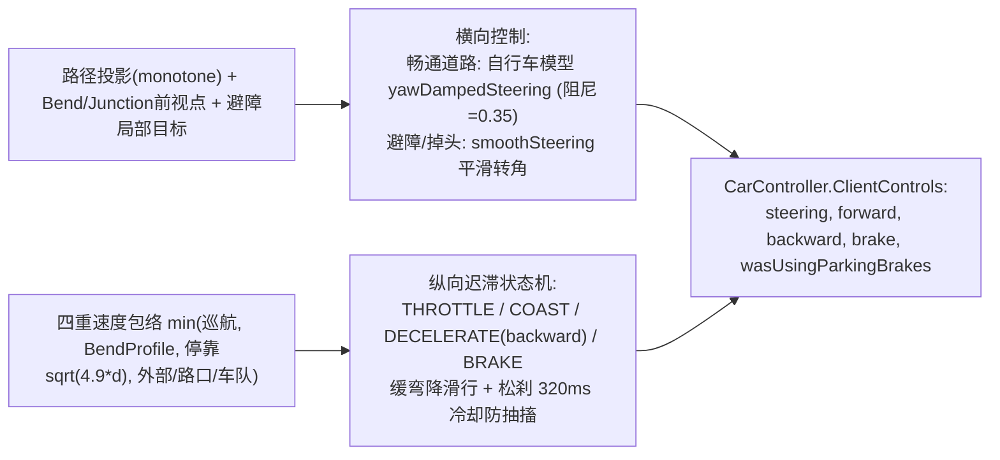

# 05 自主车辆驾驶、路网与同乘系统（全 34 类全链路）

> 覆盖源码：`npcfw/vehicle/*`（全部 34 个 Java 类）、`roadgraph.bin`、`BaseVehicleExitPatch.java`、`ExitVehicleLeaf.java`、`NPCFW_VehicleActions.lua`。

---

## 1. 上下车、选座、门前防卡与退场解冻（`VehicleAccess` + `BaseVehicleExitPatch`）

### 1.1 几何建模与乘员不变量
- **`VehicleGeometry`（按 `VehicleScript` 弱缓存）**：提取 `halfWidth`（常规 `[0.34, 1.35]`，履带车扩至 `2.1`）、`halfLength`（`[0.8, 3.2]` / `3.8`）、轮距 `wheelbase`、后轴偏移 `rearAxleOffset`、最大舵角 `maxSteeringAngle`（`[0.18, 0.58]` rad）及最小转弯半径 `minimumTurnRadius ∈ [2.6, 8.5]` 与扫掠半宽 `sweptHalfWidth`；探测 `"Track_1"` 与 `"TankTransmission"` 支持履带车原地转向与无视丧尸。
- **座位锁与同步修复**：`PASSENGER_BINDINGS`（乘客绑定）与 `VEHICLE_ENTRY_RESERVATIONS`（入口终席互斥锁）追踪占座；`reconcilePassengerPosition` 在座位表偶发丢失时调 `enterRSync` 自动重挂座；`swapSeats` 支持车内安全交换双人座位。
- **贴车防卡脱困**：`steerOutOfVehicleContact` 检出与 `BaseVehicle.getPolyPlusRadius()` 相交或 `< 0.05` 格时，用 `0.6 * normal + 0.8 * tangent` 沿车身切线滑出（优先于玩家避让执行）。

### 1.2 两阶段并发上车与通道座排序（`NPCFW_VehicleActions.lua` + `IsoNPC`）
1. **Java 选终席并集结**：`findAvailableSeat` 先问原版 `getBestSeat`，再按距离评分挑未占空席并预留；静止车取门外点外推 `0.75m` 为集结等待点（移动车动态算外推 `max(W,L)+0.9m` 追车点），由 `NavMover` 跑至集结点 `<= 0.35m` 等待。
2. **Lua 车门序列化与“穿座优先”排序**：
   - `findEntrySeat` 允许先找同侧连通且可 `canSwitchSeat` 的前门/通道座作为 `entrySeat`；
   - `tryClaimEntryDoor` 按 `doorKey` 对同一车门排独占锁，并以 **`entryPrecedes` 强制让需要借门穿入内座/后座（`entrySeat != finalSeat`）的成员先登车**，杜绝坐外座的人堵死通道；
   - 车速 `<= 0.8 km/h` 且距门 `<= 2.0` 格时串联原生 TimedAction：`ISPathFindAction:pathToVehicleSeat`（Java 侧用 `followPathNext` 驱动贴门步）→ 拔门上钥匙/解锁 `ISUnlockVehicleDoor`（无钥匙等待 120s 并催玩家开锁）→ 开门 → 登车 → 换座 → 关门；失败支持 1 次换门重试或 `2.0m` 内近距兜底 `enter + OnEnterVehicle`。

### 1.3 下车全链路与 `BaseVehicleExitPatch`
- **`ExitVehicleLeaf`**：车停稳后触发原版 `ISSwitchVehicleSeat`（若门被堵）+ `ISVehicleMenu.onExitAux`，排空 8 tick 过渡动画或 240 tick 超时硬兜底；下车后由 `FollowLeaf.resetAfterVehicleExit` 强制推离车身 `0.52m` 防卡车门碰撞。
- **`BaseVehicleExitPatch`**：
  1. `updatePhysics()` 入口判 `physics == null` 返回（防离屏/恢复阶段 NPE 崩溃）；
  2. 在 `BaseVehicle.setCharacterPosition(..., "outside")` 返回前捕获通知 **`clearPostExitMovementLocks`**：清除在非本地 `IsoPlayer` 上经常残留的 **20 余项物理/动画/碰撞死锁标志**（`blockMovement / ignoreMovement / collidable / vehicle4TestCollision / Collided* / pathing / bEnteringVehicle / bExitingVehicle / bSwitchingSeat`），并同步格指针与动画状态机切回 `PlayerMovementState`。
- **PapaChad 武装载具兼容**：通过 Kahlua 闭包反射提取私有炮控函数/弹道表并按载具键隔离冷却，1 号位 NPC 控炮时屏蔽 0 号位玩家鼠标开火，且按簇数与爆炸安全半径智能切换高爆弹或同轴机枪。

---

## 2. 离线/在线双尺度道路拓扑与几何建模

| 层级 | 核心类 | 核心原理与算法细节 |
|---|---|---|
| **离线压缩路网** | `PackedRoadGraph`、`VehicleRoadGraphShadow` | 加载 `media/npcfw/roadgraph.bin`（Big-Endian `"NPRG"` v1）：24B CSR 节点（含 `flags&1` 路口标记）+ 16B 有向边 + `spatialCellSize` 空间哈希。用 **`ThreadLocal<SearchWorkspace>` 递增世代戳 + 扁平最小堆实现微秒级零 GC A\***，支撑 3×12 候选起终点规划与沿途 `±10` 格路口提取合併。 |
| **外部路网桥** | `VehicleRoadGridRouteProvider` | 通过 Lua `NPCFW_buildAutoDriveRoadGridRoute` 只读对接第三方 *AutoDrive* 路网。 |
| **在线局部 `80×80` 车道图** | `LaneGraphCache` (12 LRU) → `RoadRaster` → `RoadSkeleton` → `LaneGraphBuilder` | 以 `32` 格步长划区扫 `80×80` 格可信路面（排除纯 Meta 无贴图 `nav_only`）→ 8 邻域 Chamfer 距离变换算路缘距 → **160 轮 Zhang-Suen 细化**抽单像素骨架并裁 `<=3` 格毛刺 → 聚类分叉/端点 → **3 步中心线精修**：① 法向横断面 `roadBand` 重定中（1/3 分位路宽滤除路口胖块 + 斜率限幅 `0.12` + 路口锚点对齐）；② 消除离散网格锯齿；③ `0.32` 格 Douglas-Peucker 简化 → 对 `width >= 3.4` 生成双向车道，并在路口构造 15 点**三次贝塞尔连接器**（校验左右 `±0.55` 格路面）。 |
| **即时曲率与路口剖面** | `VehicleRoadModel`、`VehicleJunctionProfile`、`VehicleBendProfile` | `JunctionProfile` 融合语义与离线图路口，`>25°` 转向进前收紧前视与投影上限防跳段，并按 `sqrt(v_apex² + 6.3*d)` 预减速；`BendProfile` 先滤除锯齿伪曲率，按向心加速 `6.4 m/s²` 算各点限速并反向传播 `3.1 m/s²` 制动包络。 |

---

## 3. 宏观规划与非对称靠右引导线（`VehicleDrivingLine`）

- **靠右行驶偏置公式（`VehicleDrivingLine`）**：所有道路中心线与轨迹均对齐至车辆**后轴左偏半个车宽处的引导点**：
  $$\text{guide}_X = \text{body}_X + f_x \cdot \text{rearAxleOffset} + f_y \cdot \text{halfWidth},\quad \text{guide}_Y = \text{body}_Y + f_y \cdot \text{rearAxleOffset} - f_x \cdot \text{halfWidth}$$
  （PZ `+X` 东、`+Y` 南中 `(+f_y, -f_x)` 为左侧法向），使引导点贴路中走时**车身自然处于道路右侧车道**，同时下游碰撞扫掠包络均采用与引导点匹配的非对称左右半宽！
- **多源组合语义路由 `VehicleSemanticRoutePlanner`**：按 `AutoDrive → roadgraph.bin → 在线 8 方向带转向代价格级 A*(VehicleRoadPath)` 生成 `globalIntent`，再嵌套 80×80 局部 `LaneGraph` 用 Dijkstra 沿车道+贝塞尔连接器重写当前出口内最优轨迹，拼接全局后段并支持行驶中滚动接力。
- **任意空地离路/停靠接入 `VehicleLocalAccessPlanner`**：`(x, y, dir∈0..7)` 状态空间（禁 180° 瞬掉，65000 状态上限），沿非对称 4 条纵线每 `0.35m` 检 `IsoGridSquare` 与 `PolygonalMap2` 与车体碰撞，二次贝塞尔圆角后无缝前后拼入主路网（`connectLoadedExact` 对首点错位 >0.25 格直接拒绝接单）。

---

## 4. 三层避障、丧尸聚类、五次多项式绕行与 K-Turn 掉头

### 4.1 `VehicleObstacleScanner` 前视感知（`12..44m` 自适应扫描 `45..120ms`）
1. **静态细粒度碰撞位掩码**：区分全实心格 `FULL` 与 `0.08m` 薄壁边（`NORTH / WEST` 墙/栅栏），5 线扫掠 + 车体 OBB SAT 检测；遇硬阻塞时做全场空隙扩展分析，若完整加载且全无通道则置 `localPassageImpossible` 触发全局绕路。
2. **动态车辆集群**：速度 `> 2km/h` 走运动预测，静止事故车按纵向 `<=3.0m` / 横向 `<=1.6m` 合并为联合包络，防止面对多车连环撞逐辆穿缝卡死。
3. **人物与丧尸势场（`VehicleZombieField`）**：BFS 聚群（上限 64 只，密集尸群判据 `cluster >= 4` 等），自动豁免倒地/爬行、贴侧边及低速下保险杠处丧尸防被单尸钉死。
   - **分级通行决策**：首选路面内零碰撞轨迹；次选 **`findControlledZombieContact`**（绝不撞活人前提下挑撞丧尸最少轨迹，按撞击数限速 **7 / 9 / 12 / 28 km/h** 低速可控挤过）；仅大尸群阻塞时短暂借路肩绕行并须回归路面（限速 `28 / 18 km/h`）。

### 4.2 五次多项式 Frenet 绕行与脱困升级
- **`APPROACH → PASS → REJOIN`**：用 `C²` 连续五次多项式偏移引导线，`footprintSweepSafe` 以 `0.28m` 步长复原车体中心做 OBB 扫掠，并内置 `StaticSweepState` **允许起始已经贴碰物体的车辆只要穿透深度单调减小即可逃出**。
- **`VehicleBypassState`**：入弯 `<= 900ms` 发现对侧路况明显更优可单次换侧；超过障碍车尾后提前回正并用 1.1s/3.2s 冷却防止尾扫震荡；卡住 `1450ms` 按 **`REPLAN_LOCAL → REVERSE_CLEARANCE → REPLAN_GLOBAL`（创建 `VehicleRouteBlockage`）** 三阶升级。
- **4 弧保守 K-Turn 掉头（`VehicleTurnaroundManeuver`）**：夹角 `> 112°`（避障中 `> 132°`）且低速触发；用后轴自行车模型以 3 档半径检查前左/前右/后左/后右 4 条圆弧净空。空间足则单弧满舵前转至 `<= 104°`；不足则执行 `FORWARD_ARC(准备角) → BRAKE_TO_REVERSE → REVERSE_ARC(反打 7 km/h 实时扫后方) → FORWARD_EXIT(9.5 km/h)` 三点掉头！
- **常规撞停脱困（`VehicleRecoveryGate`）**：踩油门 2200ms 不走先重规划局部绕行，再扫描 `7` 档倒车转向角倒足安全距离并加推进 `4m` 锁定防进退死循环。

---

## 5. 物理级横纵向控制闭环、车队跟驰与离屏 `MetaDrive`

- **核心物理控制细节**：
  - PZ 车辆 3D 前向向量在水平面的分量是 `(v.x, v.z)`（而非 `y`）；无物理控制器自愈支持按 `sqlId` 重绑定并调用 `vehicle.createPhysics()`；
  - 纵向严格互斥写入，利用原版 `backward=true` 在车速 `> 1.5 km/h` 时充当渐进行车减速，低于 `1.5` 或驻车才给硬 `brake`；
  - 从制动切回滑行设 `320ms` 禁给油门防频踩抖动。
- **车队跟随（Convoy）**：头车沿路径前推 `32..52m` 作跟驰引导点（仅在偏移 `>=24m` 或尾端时重算）；结合沿路径投影距 `convoyProjectedGap` 与相对碰撞时间 `TTC <= 0.75s` 触发紧急制动，落后时按超距 `1.5x` 动态追赶。
- **离屏虚拟驾驶（`MetaDriveState`）**：车辆因远离玩家离屏且车上无真实玩家时，将 NPC 设为离屏休眠、按路线里程匀速推进 `metaX/Y/Heading` 并同步 `NPCData`；一旦前进 `>= 8m`（或到站）且目标格区块重新加载、无车体碰撞，调 `VirtualVehicleManager.removeFromMeta` + 同步 `jniTransform` + `addToWorld` + `ensureLoadedVehiclePhysics` + 乘员 `enterRSync` + 恢复引擎无缝复活回物理自动驾驶！
- **20Hz 168 列遥测录制器（`VehicleDrivingRecorder`）**：每 `50ms` 输出位姿、曲率、路面源、横断面、掉头净空、障碍点列至 CSV 供调参剖析。
