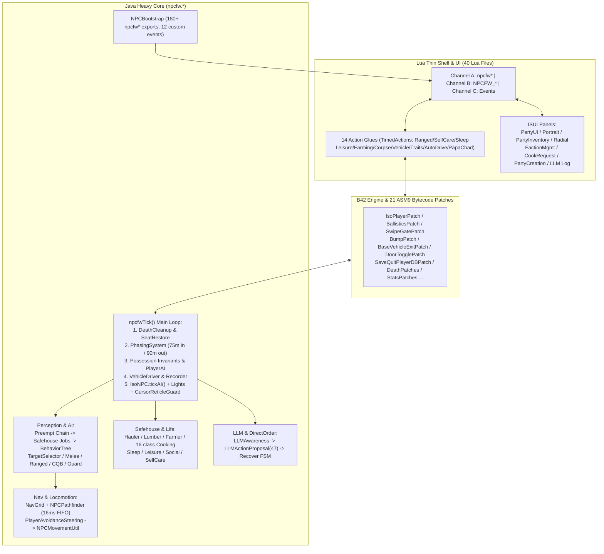

# ProjectRemnants（`npcfw`）全链路净室架构参考库

> **文档定位**：本参考库面向 **EmberRoutes V2** 工程团队，对 `ProjectRemnants`（包名 `npcfw`）在 Project Zomboid B42 下的完整设计机制、引擎交互边界、ASM 字节码补丁、AI/寻路/战斗/据点/驾驶/Lua 胶水与 LLM 链路进行**净室（Clean-Room）系统化梳理**，严禁逐段照抄原 Mod 源码；所有阈值、公式、状态机与 B42 原版钩子定位均已核对。

---

## 1. 审计基准与资产盘点

- **Steam Workshop 对齐校验**：
  - Workshop ID：`3738362476`
  - ACF Manifest：`4903201350817220449`（`timeupdated = 1790202427`）
  - 核心包校验：`NPCFW.jar`（`2,263,333` bytes，SHA-256 `5229EB5A6871514DE274FEB91E8DB353FDBDE8FB42FD9741493D40CDE85BA19E`）与全部 46 个 Lua/翻译文件与本地归档 100% 一致
  - Java 范围：`218 / 218` 个顶级类（`npcfw.*`）
- **非 Java 资产统计**：
  - `42/media/lua/`：40 个 Lua 脚本（`shared/`、`client/`、`client/ISUI/`、`common/media/lua/client/NPCFW_ModOptions.lua`）
  - `42/media/sandbox-options.txt`：10 项沙盒配置（页名 `ProjectRemnants_NPCNeeds`）
  - `42/media/AnimSets/`：27 个动画状态树 XML（17 个警卫持枪待机 + 5 个家具睡 + 5 个地板睡）
  - `42/media/anims_X/Bob/`：12 个 `.glb` 自定义骨骼动画（警卫步枪待机/换姿/扫视）
  - `42/media/npcfw/roadgraph.bin`：预编译离线压缩道路拓扑图（`"NPRG"` v1）
  - `42/media/lua/shared/Translate/`：5 种语言（`EN / IT / JP / PTBR / RU`），含 `IG_UI.json` 与 `Sandbox.json`

---

## 2. 分册阅读导航

| 章节文件 | 覆盖源码包 / 资产 | 核心内容摘要 |
|---|---|---|
| [01-core-lifecycle-patches.md](file:///c:/Users/MuMu/Zomboid/Workshop/EmberRoutesV2/docs/references/project-remnants/01-core-lifecycle-patches.md) | `npcfw/patch/*`（21）、`npcfw/core/*`（22）、`npcfw/data/*`、`npcfw/ui/*`、`npcfw/modules/*` | 全部 21 个 ASM9 字节码补丁逐条解析；Agent 启动与 14 步帧主循环；`IsoNPC` 物理/AI 双管线；单槽位隔离、`NPCPossession` 夺舍与 `CursorReticleGuard` 防抢；`PhasingSystem` 滞回卸载；`NPCFW_Data.bin` 原生 `ByteBuffer` 快照；死亡转尸 `retiredAnimationPlayers` 陷阱；小队连结/陪睡/医疗自理/光源/经验/特质兼容 |
| [02-ai-perception-combat-guard.md](file:///c:/Users/MuMu/Zomboid/Workshop/EmberRoutesV2/docs/references/project-remnants/02-ai-perception-combat-guard.md) | `npcfw/ai/**`、`tasks/AttackExecutor`、`utils/NPCCombatAudio`、`safehouse/guard/*`、17 个警卫 XML | 无状态反应式行为树（Reactive BT）拓扑与跟随拴绳；`NPCAssignment` × 阵营交战闸门；视听双通道感知与衰减公式；目标评分/防抖/近战认领；近战 8 向承诺站位/连续间距控制/硬直压制/推搡踩踏；远程 `NPCVirtualAim` 逆投影与弹道劫持；室内 CQB 扇区与换弹锁；`FollowLeaf` 编队/楼梯队列；据点守卫弹药后勤与 16 步步枪待机 AnimSet |
| [03-nav-locomotion-avoidance-tasks.md](file:///c:/Users/MuMu/Zomboid/Workshop/EmberRoutesV2/docs/references/project-remnants/03-nav-locomotion-avoidance-tasks.md) | `npcfw/nav/*`、`utils/NPCMovementUtil`、`tasks/*`、`inventory/NPCContainerAccess` | `playerMoveDir` + `AIBrainPlayerControlVars` 旋转投影防滑步；`getDeferredMovement` 根位移截断防过冲；3D 楼梯锚点建模 + 自适应抽稀 `NavPath`；全局 `16ms` 单槽 FIFO 寻路限流；`NavSpeedPolicy` 四重降速；`NavInteract` 与 `DoorToggleObserverPatch` 随手关门纪律；**三层正交玩家避让体系**（`PlayerAvoidanceSteering` + `FollowLeaf` + `IsoMovingObjectBumpPatch`）；`NPCContainerAccess` 与 10 大原子任务执行器 |
| [04-safehouse-economy-cooking-life.md](file:///c:/Users/MuMu/Zomboid/Workshop/EmberRoutesV2/docs/references/project-remnants/04-safehouse-economy-cooking-life.md) | `npcfw/safehouse/*`（除 guard 外 54 类，含 `cooking/*` 16 类、`leisure/*` 6 类、`social/*` 2 类）、10 个睡眠 XML | `FactionBase` 与 `SafehouseManager` 矩形合并/区域渲染；6 大仓储分类器与防乒乓搬运；搬运工/伐木工（50% 滞回与地面溢出）/农夫三工种全链路；`SafehouseFoodSystem` + `RecipeCookingService` 流体解析与防环多步烹饪；双路径睡眠（家具 Prototype vs 地板动画控制器）与三套恢复态；19 种休闲活动与 `LeisureTemporaryItemManager` 防泄漏闭环；双人社交 |
| [05-vehicle-autonomous-driving.md](file:///c:/Users/MuMu/Zomboid/Workshop/EmberRoutesV2/docs/references/project-remnants/05-vehicle-autonomous-driving.md) | `npcfw/vehicle/*`（34 类）、`roadgraph.bin`、`NPCFW_VehicleActions.lua` | 几何建模、选座排序、两阶段门前排队与 `BaseVehicleExitPatch` 解锁防僵；PapaChad 炮塔反射兼容；`roadgraph.bin`（`"NPRG"`）零 GC 规划与 `80×80` LRU 局部 `LaneGraph`（Zhang-Suen 细化 + 断面定中 + 三次贝塞尔连接器）；三层 `VehicleObstacleScanner`、丧尸聚类控速挤过与五次多项式 Frenet 绕行；4 弧 K-Turn 掉头与脱困升级；`CarController.ClientControls` 偏航阻尼驾驶、车队 TTC 跟驰与离屏 `MetaDrive` |
| [06-lua-bridge-ui-llm-assets.md](file:///c:/Users/MuMu/Zomboid/Workshop/EmberRoutesV2/docs/references/project-remnants/06-lua-bridge-ui-llm-assets.md) | `npcfw/conversation/*`（5）、40 个 Lua 文件、`sandbox-options.txt`、媒体资源清单 | Java↔Lua 三通道通信与 `WeakKey` + `token` + 1-tick `SignalAction` 同步范式；14 个 Lua 原生动作胶水；`PartyUI`/`PartyPortrait`/`PartyInventoryUI`/`FactionManagementUI`/画笔/烹饪/多幸存者建人等完整 UI 架构；`Gibberish` + `LLMConversationService` 三路由推理（环回硬锁）+ `LLMAwareness` 防幻觉 + `NPCDirectOrderController` 47 动作安全执行与 `RECOVER` 归还闭环；10 项沙盒配置 |

---

## 3. 全局分层架构与帧调度流图

---

## 4. 21 个 ASM 字节码补丁总索引

| # | 补丁类 | 目标类（方法） | 核心用途 |
|---|---|---|---|
| 1 | `IsoPlayerPatch` | `IsoPlayer`（5 个方法） | 劫持 `getAimVector`/`setAngleFromAim`；阻断非主控 AI 调用 `updateCursorVisibility` 隐藏鼠标；放行 AI 原主角 `isWeaponReady`；跳过 `updateInternal2` 键鼠覆写 `playerMoveDir` |
| 2 | `FBORenderCellPatch` | `FBORenderCell.renderMovingObject` | 防止附身 `IsoNPC` 双重渲染、防止非本地化原主角隐身 |
| 3 | `FBORenderAreaHighlightsPatch` | `FBORenderAreaHighlights.render` | 挂接 OpenGL 深度测试安全屋地板高亮 `SafehouseAreaRenderer` |
| 4 | `IngameStateActionProgressPatch` | `IngameState.renderFrame[Text]Internal` | 修复玩家槽位进度条防污染，在世界地图文字层前渲染 NPC 头顶进度条与经验飘字 |
| 5 | `BallisticsControllerPatch` | `BallisticsController.update` | 按持枪者把 `AimingReticle.getX/Y` 重定向至 `NPCVirtualAim` 虚拟准星 |
| 6 | `CombatManagerPvpPatch` | `CombatManager.checkPVP` | 单人模式下仅对显式敌对阵营放行玩家/NPC 相互伤害，保护友军 |
| 7 | `IsoGameCharacterStatsPatch` | `IsoGameCharacter.updateStats_WakeState/updateThirst` | 为队友/居民与 AI 原主角放行原版疲劳与口渴生理演化 |
| 8 | `IsoGameCharacterWeaponReadyPatch` | `IsoGameCharacter.isWeaponReady` | 为 AI 原主角放行武器就绪门控 |
| 9 | `IsoGameCharacterNamePatch` | `IsoGameCharacter.renderlast/updateUserName` | 单人模式下复用原版 `TextDrawObject` 头顶名字管线 |
| 10 | `UIWorldMapPlayerPatch` | `UIWorldMap.render` | 复用原版世界地图蓝点/文字绘制存活 NPC 与 AI 原主角 |
| 11 | `SwipeStatePlayerAttackGatePatch` | `SwipeStatePlayer.OnAnimEvent_AttackCollisionCheck`、`isStompingDisabled` | 放行非本地 NPC 近战/踩踏碰撞判定，屏蔽已直接结算过的枪击防双倍伤害 |
| 12 | `IsoPlayerIsJustMovedPatch` | `IsoPlayer.isJustMoved` | 无键盘输入时凭非零 `playerMoveDir` 让 `isNpc()` 角色正常驱动动画 |
| 13 | `IsoMovingObjectBumpPatch` | `IsoMovingObject.separate` | 钩 A 禁止已在 `"bumped"` 态重复刷新；钩 B 受开关控制跳过玩家↔NPC/NPC↔NPC 绊倒但保留物理推开 |
| 14 | `IsoPlayerDeathEventPatch` | `IsoPlayer.OnDeath` | 主控死亡且小队有幸存者时吞掉 `OnPlayerDeath` 触发死亡继任接管 |
| 15 | `IsoPlayerAllPlayersDeadPatch` | `IsoPlayer.allPlayersDead` | 小队尚有存活成员时返回 `false` 防止提前 Game Over |
| 16 | `SaveQuitPlayerDBPatch` | `GameWindow`/`IngameState`/`PlayerDB.savePlayerAsync` | 存盘前自动回归存活原主角，防止 `IsoNPC` 污染原版 `players.db` |
| 17 | `XPShortOverloadPatch` | `IsoGameCharacter$XP`（4 短重载） | 绕过本地玩家限制真实发放经验并转由 `NPCFloatingXPText` 飘字 |
| 18 | `CraftRecipeXPPatch` | `CraftRecipe.addXP` | 放行非本地 NPC B42 配方制造经验发放与头顶飘字 |
| 19 | `DebugTypeWarnPatch` | `DebugType.warn` | 抑制特定高频蒙皮空指针警告刷屏 |
| 20 | `BaseVehicleExitPatch` | `BaseVehicle.setCharacterPosition/updatePhysics` | 捕获下车 `"outside"` 清空20+移动碰撞锁；守护 `physics == null` 防 NPE |
| 21 | `DoorToggleObserverPatch` | `IsoDoor/IsoThumpable.ToggleDoor` | 实时上报门开关事件，驱动 `NavInteract` 随手关门纪律 |

---

## 5. 与 EmberRoutes V2 模块对标矩阵（取舍指南）

| EmberRoutes V2 里程碑 | ProjectRemnants 最值得借鉴的核心机制 | EmberRoutes V2 明确不采纳/已改进的设计 |
|---|---|---|
| **M2 躯壳与运动解耦** | ① `IsoPlayerPatch` 保护鼠标隐藏与 `updateInternal2`； ② `IsoMovingObjectBumpPatch` 保留物理分离但抑制友方绊倒； ③ **`PlayerAvoidanceSteering`**（1.45m 前瞻、静止 `staticPass` 锁侧、900ms 防抖、1400ms 窄道礼让后挤过）； ④ `retiredAnimationPlayers` 弱集防死亡转尸复用到对象池 | 不做任何 `IsoPlayer.players[]` 附身与原主角接管；全局寻路用 C++ `PathfindNative` + `PolygonalMap2` 替代自研跨城网格 A\*；不复辟 120 处静态常量与旧死代码 |
| **M3 原子动作、StateTree 与仓储** | ① **`LeisureTemporaryItemManager`** 临时道具令牌/五戳/读档扫荡闭环； ② **`NPCContainerAccess`** 正交邻格+防隔窗+不可绕行校验； ③ 家具/地板睡眠双路径 + 3s `WakeRelease` 防滑步； ④ 仓储 `isStrictRoleImprovement` 防死循环 | 不用散落在 5 个 Job 中的私有 `RESERVATIONS` 表，收归单一 `SmartObjectRegistry` + `SettlementTaskAuctioneer` 组合拍卖；不用反应式无记忆 BT |
| **M4 随从编队、载具与战斗** | ① **C1–C7 战斗闭环**（`NPCVirtualAim` 逆投影、`BallisticsController` 劫持、`StaggerPressure` 1.8s 破绽压制、`MeleeCombatNode` 0.2m 死区与死区截断、`CQBMode` 纵横自动切换与 64 点面包屑、`TargetSelector` 80ms 错峰评分防抖）； ② `VehicleAccess` 两阶段登车（门前先通道座排序）+ `BaseVehicleExitPatch` 20+ 状态解冻 | 战斗协同由 `EmberSquadDirector` 与 `FiringCorridor` 射界斥力承担；保留原版 `GameWindow.save` 坐车热存盘约定 |
| **M5 生产工种与烹饪** | ① **16 类 `safehouse/cooking/*`**（`CookingContextSnapshot` 避开玩家打开炉灶、`WaterRequirementResolver` 流体求解、`RecipePipelineGuard` 8 层防环、`replaceOnCooked` 实例追踪）； ② 借用工具 ModData 来源戳自动归还； ③ 伐木 `50%` 滞回配额与 `SafehouseWorkRestController` | 配方执行直连 B42 `HandcraftLogic / CraftLogic` 与 `MetaEntitySystem` 调度，不复制硬编码农作物布局到两份 |
| **M6 多社区经济与真车商队** | ① `CarController.ClientControls` 真物理驱动 + `VehicleDrivingLine` 靠右偏置； ② `yawDampedSteering` 抑制高速画龙； ③ 五次多项式避障轨迹 + 4 弧 K-Turn 掉头； ④ `MetaDrive` 实体化与安全还原 | 宏观路网直接基于原版 `WorldMapStreets` / `streets.xml`，免去维护离线 `roadgraph.bin` 生成器；真车离屏托管走 `VehiclesDB2` |
